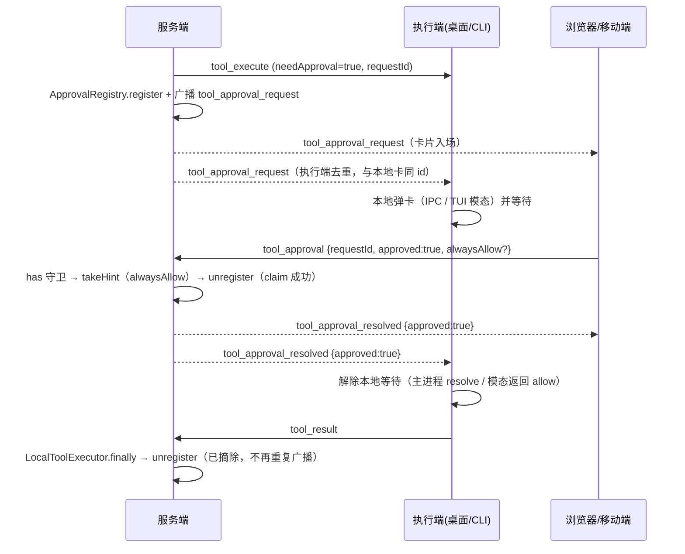

# LOCAL 任务多端审批技术方案（浏览器 / 移动端可审批本机工具调用）

- 状态：**已评审确认**（2026-11-06；三点取舍按本文定稿，见 §11。**本轮不进入功能开发**）
- 关联方案（前置基建，已落地）：
  - [2026-11-05-local-task-device-delegation-technical-design.md](./2026-11-05-local-task-device-delegation-technical-design.md)：LOCAL 会话创建时绑定执行端设备（`session.target_device_id / target_device_name`）、`sendToDevice` 定向投递、浏览器可接管已有 LOCAL 会话的对话。**本方案完全建立在这套设备维度之上，不新增执行模式、不改委托通道。**
  - [2026-06-25-ask-user-questions-design.md](./2026-06-25-ask-user-questions-design.md)：`ask_user_questions` 的跨端「广播 + 先到先得 + 订阅重放 + 取消撤卡」形态，是本方案要对齐的既有范式。
- 相关既有实现（撰写时已核实）：
  - 服务端注册表：`backend-ts/src/harness/approval/approval-registry.ts`（`register` / `unregister` / `takeHint` / `has` / `countForSession`）
  - 审批登记点：`backend-ts/src/harness/local/local-tool-executor.ts`（`sendToolRequest` → `approvalRegistry.register` → 收件箱待办 → 3 分钟升级提醒 → `Promise.race(future, 900s)`，`finally` 统一 `unregister`）
  - 决策入口：`backend-ts/src/session/ws/streaming-ws-handler.ts` 的 `handleToolApproval`（`~1135`）与分发 `case 'tool_approval'`（`~560`）
  - 订阅重放先例：同文件 `handleSubscribe`（`~611-620`，`ask_user_questions` 的 pending 重放）
  - 广播/定向投递：`backend-ts/src/session/ws/streaming-ws-registry.ts` 的 `send(userId, event)`（该用户全部连接）、`sendToDevice` / `getDeviceExecutorSocket` / `hasDeviceConnection`
  - 桌面端：`desktop/electron/main.cjs` 的 `requestToolApproval`（`~719`）与 `ipcMain.handle('tool-approval-response')`（`~742`）、`desktop/electron/preload.cjs`、`desktop/src/composables/useChat.ts` 的 `pendingApprovals` / `ensureApprovalListener` / `confirmApproval`、`desktop/src/composables/useStreamWS.ts` 的 `routeEvent` / `sendToolApproval`
  - 审批卡片：`desktop/src/components/chat/ApprovalStack.vue`（拒绝 / 总是允许 / 执行，`handledIds` 防重复），已在 `ChatPanel`、`SideChatPanel`、`SubagentChatPanel` 三处使用
  - CLI：`agent-cli/src/local/executor.ts`（`ask` / `approveShellText`，多处 `sendReliable({type:'tool_approval', ...})`）、`agent-cli/src/tui/ink-renderer.ts`（`requestApproval` + `modalQueue`，`ask` 的 `setAskResolver` / `deliverAsk` 缓冲范式）、`agent-cli/src/tui/modal-controller.ts`（`ApprovalController`）
- 一句话：LOCAL 工具需要审批时，**服务端把审批请求广播给该用户的所有在线端**，任意一端「执行 / 拒绝 / 总是允许」都由服务端**先到先得**判定，再广播「已处理」把各端卡片撤掉，并让**执行端本地的 IPC / TUI 等待被同一份决策解除**。

## 0. 名词约定

| 名词 | 含义 |
|---|---|
| 执行端 / 设备 | 真正执行 LOCAL 工具调用的客户端：桌面 Electron、`mao-agent` CLI。由会话的 `targetDeviceId` 指定（2026-11-05 方案） |
| 审批端 | 收到审批卡、可以点「执行 / 拒绝 / 总是允许」的任意在线端：桌面、浏览器、移动端 Web、CLI TUI |
| 审批请求 | 一条具体的待审批工具调用，主键是服务端 `tool_execute` 下发的 `requestId`（`randomUUID`） |
| 决策 | `approved: true/false` + 是否 `alwaysAllow`；由审批端产生 |
| 认领（claim） | 服务端对同一 `requestId` 只接受第一个决策，后续决策一律忽略 |

## 1. 需求背景

### 1.1 现状

| 能力 | 现状 | 证据 |
|---|---|---|
| 审批卡在哪里出现 | **只在执行端本机**：Electron 主进程 `requestToolApproval` 发 `tool-approval-request` IPC，渲染层 `pendingApprovals` 收下并渲染 `ApprovalStack`；CLI 走 Ink `requestApproval` 弹模态 | `main.cjs:719`、`useChat.ts:54-80`、`ink-renderer.ts:604` |
| 浏览器 / 移动端 | `ensureApprovalListener()` 首行 `if (!window.electronAPI) return`——**浏览器拿不到任何审批事件**，页面上没有任何可点的卡 | `useChat.ts:55` |
| 服务端掌握的信息 | 只登记「这个会话有 N 条审批挂着」：`ApprovalRegistry.pending` 存 `sessionId → Set<requestId>`，`hints` 存「总是允许」模式；**不存工具名、参数、危险原因、设备** | `approval-registry.ts:9-11`、`register()` |
| 服务端登记后的动作 | `enterWaitingApproval` + 广播 `session_status / session_list_update (WAITING_APPROVAL)`；站内收件箱待办；3 分钟无人处理升级提醒 | `approval-registry.ts:29-40`、`local-tool-executor.ts:60-85` |
| 决策上行帧 | 已存在：`{type:'tool_approval', sessionId, requestId, approved?, alwaysAllow?}`。桌面 `confirmApproval` 已带 `approved`；**CLI 不带**（只表示「人已经表态」） | `useStreamWS.ts:592-601`、`agent-cli/src/local/executor.ts:157/172/179/268/274/280` |
| 服务端收到决策后 | 只在 `alwaysAllow===true && approved===true` 时 `takeHint` + 建会话规则；然后 `unregister` + 树信号刷新 + 抑制升级提醒。**不向执行端下发任何东西，也不通知其他端** | `streaming-ws-handler.ts:1135-1162` |
| 跨端广播能力 | 已有：`registry.send(userId, event)` 把帧投给该用户**全部**连接（`ask_user_questions` 就靠它广播、并按 `requestId` 先到先得） | `streaming-ws-registry.ts` 的 `deliver()` `ALL` 分支、`streaming-ws-handler.ts:1193-1212` |
| 订阅重放能力 | 已有：`handleSubscribe` 在会话活跃时重放 `ask_user_questions` 的 pending 列表 | `streaming-ws-handler.ts:611-620` |
| 设备维度 | 已有：会话绑定 `targetDeviceId/Name`、`resolveTarget(sessionId)`、`sendToDevice`、设备断线 `failAllForSocket/Device` | 2026-11-05 方案与实现 |
| 生命周期清理 | 单一收敛点：`LocalToolExecutor.finally` 必调 `unregister`（覆盖批准 / 拒绝 / 结果返回 / 900s 超时 / 断连 / 执行异常） | `local-tool-executor.ts:96-125` |

### 1.2 问题

以用户截图场景为例：Mac 上用 `mao-agent` 创建本地任务，人在浏览器 / 手机上继续对话，Agent 触发一个需要审批的 `shell` 调用——

1. **审批请求到不了浏览器 / 移动端**：服务端从未把「审批内容 + requestId」发出去，前端也没有监听入口；用户只能看到会话处于「等待审批」，看不到任何可操作的卡片。
2. **即使点了也没用**：假设前端硬发一帧 `tool_approval`，服务端只会把 pending 摘掉（连「总是允许」规则都可能被建），但**不会把决策送回执行端**——Mac 上的 CLI 仍停在模态里等键盘输入，任务照样卡住。这正是「必须回到 Mac 点」的根因。
3. **反向也不一致**：在 Mac 上点了之后，其他端没有「已处理」信号，卡片（若存在）与计数只能等下次刷新；多端并发时也没有任何仲裁语义（谁先谁后、重复点击怎么办）。

### 1.3 机会

- `ask_user_questions` 已经把「多端广播 + 先到先得 + 订阅重放 + 取消撤卡」跑通，审批需要的骨架是同一套，**不需要新造通道**。
- `tool_approval` 上行帧、`ApprovalStack` 卡片组件（含三按钮与 hint 文案）、`pendingApprovalCount` 计数链路、`sendToDevice` 定向通道、`resolveTarget` 设备解析**全部已存在**。
- 审批的 pending 生命周期本来就有一个唯一的收敛点（`unregister`），把「撤卡广播」挂在这里即可覆盖决策 / 超时 / 断连 / 异常全部路径，不需要新增清理分支。

## 2. 需求描述

### 2.1 要做的

1. **P1-1 审批请求跨端可达**：LOCAL 工具需要审批时，服务端向该用户**所有在线连接**广播 `tool_approval_request`，载荷包含 `requestId / toolName / arguments / workspace / dangerReason / approvalHint / deviceName`；各端复用 `ApprovalStack` 渲染，按 `requestId` 去重（执行端 IPC 卡片与 WS 卡片是同一张）。
2. **P1-2 任意端都能决策**：所有端都提供「执行 / 拒绝 / 总是允许（有 hint 时）」三个动作，与桌面现有卡片行为一致；浏览器 / 移动端不再有本地 IPC 依赖。
3. **P1-3 决策必达执行端**：服务端认定某个决策后，广播 `tool_approval_resolved`；执行端的 Electron 渲染层据此调主进程解除挂起的 `requestToolApproval` Promise，CLI 据此解除 Ink 模态并返回对应 `ApprovalChoice`——**人不必回到执行端**。
4. **P1-4 多端一致**：任意端决策后，所有端移除该卡片并递减会话待审批计数；执行端本地已点过的情况同样广播，其它端卡片同步消失。
5. **P1-5 幂等与迟到处理**：同一 `requestId` 只有第一个决策生效；重复 / 迟到帧、超时后到达的帧、非 pending 的帧一律忽略，且不得创建审批规则。
6. **P1-6 重放**：新打开 / 重连的端订阅会话时，补发该会话当前所有待审批请求（镜像 `ask_user_questions` 的既有做法）。
7. **P1-7 兼容**：旧桌面端 / 旧 CLI 不认识新事件时按未知帧忽略（现状 `default: break`），不报错；旧 CLI 上行帧不带 `approved` 时按「仅通知已处理」处理，不参与决策中继。
8. **P1-8 文档同步**：根 `CHANGELOG.md`、`skills/mao-cli/` 的桌面 / Web / CLI 使用说明补充「多端审批」段落。

### 2.2 不做的（本期明确排除）

- **不做手机端系统推送 / 任何离线提醒**（用户已明确点名不加；离线端不产生卡片，回到页面靠订阅重放补齐）。
- **不做全局弹窗 / 铃铛 / 桌面通知 / 审批中心**：卡片仍只在会话内（`ChatPanel`、`SideChatPanel`、`SubagentChatPanel`）展示；其它页面只能通过会话列表的待审批徽标感知。
- **不做审批转交 / 指定审批人 / 多人会签**：同一账号的所有端地位平等，先到先得。
- **不做跨用户审批**：会话归属校验沿用 `requireOwnedSession`，审批内容只广播给会话 owner 自己的连接。
- **不做审计 / 管理后台视图 / 操作留痕新增**。
- **不改审批引擎与策略**：是否需要审批仍由 `shouldRequireApproval(permissionLevel)` 与审批规则决定；900s 超时、3 分钟升级提醒、站内收件箱待办口径全部不动。
- **不做非 TTY / 打印模式 CLI 的人工审批**：现状即「需要审批但无法交互 → 直接拒绝」（`evaluateApproval` 的 `canPrompt` 分支），本方案不改变该语义；此类设备收到卡片后会在数毫秒内被 `resolved` 撤掉（见 §7 风险）。
- **不落库**：审批公告只在服务端内存（与 `pending` 同生命周期），不新增表 / 迁移。

## 3. 关键决策（已定案）

| # | 决策点 | 拟定 | 理由与取舍 |
|---|---|---|---|
| D1 | 拓扑 | **服务端中转**：客户端只与服务端通信，不做端到端直连 / 内网穿透 | 执行端本来只连服务端；手机与 Mac 通常在两个网络。中转不需要新端口、新证书、新配对流程 |
| D2 | 广播范围 | `registry.send(userId, event)`：该用户**全部连接**（含执行端自己、浏览器、移动端、CLI） | 用户已定「所有在线端都收到审批卡」；按订阅过滤会漏掉刚打开还没订阅的端，且 `ask_user_questions` 已是全量广播 |
| D3 | 事件协议 | 新增 2 个下行事件 `tool_approval_request` / `tool_approval_resolved`；**决策上行复用既有 `tool_approval` 帧**（补 `approved`） | 复用上行帧不需要新入口与新的鉴权分支；下行拆成两个事件是因为语义不同（入场 vs 撤卡/解除等待） |
| D4 | 并发仲裁 | 服务端**先到先得**：`ApprovalRegistry.has()` 守卫 + `unregister()` 返回「是否真正摘除」；只有摘除成功的那一帧触发规则创建、撤卡广播、树信号与升级抑制 | 与 `ask_user_questions` 的 `complete()` 返回布尔一致；`pending` 是唯一权威状态，天然幂等 |
| D5 | 执行端是否保留本地审批 | **保留双通道**：执行端本地卡片（IPC / TUI）继续存在，WS 卡片同时广播；按 `requestId` 去重 | 不改造 Electron 主进程多处 `requestToolApproval` 调用点与 CLI shell 每动作复检；离线 / 旧服务端场景下本地审批仍可用。代价是执行端理论上会有两个入口，用去重与「同一决策」消除差异 |
| D6 | 决策如何抵达执行端 | **广播 `tool_approval_resolved` 即为送达**（不再单独做 `sendToDevice` 定向中继） | 执行端的 WS 连接就在渲染层 / CLI 进程里；广播天然同时满足「撤卡」与「解除等待」。定向发送反而要实现两套路径。帧加入 `CRITICAL_EVENT_TYPES`，不受增量队列容量影响 |
| D7 | 决策早到（竞态） | 两端各做**早到缓冲**：Electron 主进程 `earlyApprovalDecisions`（`requestId → decision`，TTL 10 分钟 / 上限 100 条）；CLI Ink `approvalPending`（复用 `askPending` 的既有范式） | 决策可能早于执行端本地弹卡（服务端广播先到、设备本地还没走到 `requestToolApproval`）。不缓冲就会「手机点了、Mac 没反应」 |
| D8 | 重放 | `handleSubscribe` 的 `active` 分支补 `approvalRegistry.getPendingForSession(sessionId)`，逐条重发 `tool_approval_request` | 与 `ask_user_questions` 完全同构；重连 / 新开标签页都能补卡 |
| D9 | 撤卡清理点 | 只在 `ApprovalRegistry.unregister()` 内广播 `tool_approval_resolved`（覆盖决策 / 900s 超时 / 断连 / 执行异常 / 会话中止） | `LocalToolExecutor.finally` 已经保证必调；`handleToolApproval` 也调同一方法，天然幂等，不新增第二处清理逻辑 |
| D10 | `resolved` 语义 | `approved: true \| false \| null`：`null` = 没有人工决策（超时 / 中止 / 设备策略拒绝）。Electron 一律 `approved === true` 才放行；CLI `true → allow/always`，否则 `deny` 并关闭模态 | 超时后执行端模态不能继续挂着（现状会挂到进程退出）；`null` 同时表达「卡已失效，请收起」 |
| D11 | 「总是允许」 | 规则仍只由**服务端按 `takeHint` 生成**（唯一权威）；CLI 收到 `alwaysAllow` 时额外调用 `recordAlwaysAllow` 记本进程策略（只为当前进程内后续动作不再追问） | 客户端不能注入 pattern（V135 既有约束）；服务端规则生效后下一轮 `needApproval=false`，与端无关 |
| D12 | 卡片展示字段 | 服务端下发 `toolName + arguments(原始 JSON 字符串) + workspace + dangerReason + approvalHint + deviceName`；前端用 `getToolInputPreview(toolName, args)` 渲染摘要（顺带补 `shell` 的 `write_stdin` 预览：取 `input` 而非 `command`） | 服务端不重复实现一套「描述生成」（`main.cjs` 与 CLI 各有口径）；远端卡片允许与执行端本地卡片措辞略有差异，执行端以 IPC 描述为准（D5） |
| D13 | 旧端兼容 | 旧执行端不认识 `tool_approval_resolved` → 远端决策对它无效，仍需本地点击（功能不减、不报错）；旧 CLI 的上行帧无 `approved` → 服务端只当「已处理通知」，广播 `resolved(null)` 并**不**创建规则 | 与「先部署后端再部署客户端」的发布顺序配合（§9）；不做协议版本协商，减少复杂度 |
| D14 | 状态存储 | 审批公告与现有 `pending` 一样放**单实例内存**，服务重启即丢 | 与现状 pending / 升级提醒一致；重启后本地工具等待本就无法延续（由崩溃恢复链路处理），不引入持久化成本 |

## 4. 协议与数据结构

### 4.1 WS 事件

| 事件 | 方向 | 投递目标 | 载荷（`data`） | 说明 |
|---|---|---|---|---|
| `tool_approval_request` | 服务端 → 客户端 | 该用户全部连接 | `{ requestId, toolName, arguments, workspace, dangerReason?, approvalHint?, deviceName? }` | 审批入场：渲染卡片；`arguments` 为原始 JSON 字符串；`sessionId` 在帧顶层（`wsEvent` 既有形态）。加入 `CRITICAL_EVENT_TYPES` |
| `tool_approval_resolved` | 服务端 → 客户端 | 该用户全部连接 | `{ requestId, approved: boolean \| null, alwaysAllow?: boolean }` | 撤卡 + 解除执行端等待；`approved===null` 表示无人工决策（超时 / 中止）。加入 `CRITICAL_EVENT_TYPES` |
| `tool_approval`（**既有**，不新增） | 客户端 → 服务端 | — | `{ sessionId, requestId, approved?, alwaysAllow? }` | 决策（带 `approved`）或「已处理通知」（不带）；`alwaysAllow` 仅 `approved===true` 时有意义 |

`tool_approval_request` 里 `arguments` 与 `tool_execute` 同源（`LocalToolSessionRegistry.sendToolRequest` 的入参 `argumentsJson`），保证审批端看到的就是将要执行的那份参数。

### 4.2 服务端待审批公告（内存）

`ApprovalRegistry` 在既有 `pending / hints` 之外新增公告表（key 同 `hints`：`` `${sessionId}:${requestId}` ``）：

```ts
interface ApprovalAnnouncement {
  requestId: string;
  sessionId: number;
  userId: number | null;        // 广播目标；SUBAGENT 回退父会话
  deviceId: string | null;      // 会话绑定执行端（展示用，可为空 = 未绑定旧会话）
  deviceName: string | null;    // session.target_device_name 快照
  toolName: string;
  arguments: string;            // 原始 JSON 字符串
  workspace: string;
  dangerReason: string | null;
  approvalHint: ApprovalHint | null;
  announcedAt: number;
}
```

- `register()` 时写入并广播 `tool_approval_request`；`unregister()` 时删除并广播 `tool_approval_resolved`（只在本次确实摘除时）。
- `getPendingForSession(sessionId)` 供订阅重放（返回纯 payload 数组，屏蔽内部结构）。
- 拿不到 `userId`（会话无归属等异常）时只保留本地行为，不广播。
- 重发 / 覆盖：同 `requestId` 重复 `register` 不重复广播（已存在则仅更新字段）。

### 4.3 前端 `ApprovalItem` 扩展（desktop 与 Web 共用）

```ts
interface ApprovalItem {
  requestId: string
  toolName: string
  description: string
  sessionId?: string
  dangerReason?: string
  approvalHint?: ApprovalHint
  // 新增
  source?: 'local' | 'remote'   // local = Electron IPC；remote = WS 广播
  deviceName?: string            // 远端卡片展示「在 xxx 上执行」
}
```

- 队列按 `requestId` **upsert**：`local` 到达时覆盖同 id 的 `description`（主进程口径更精确），`remote` 只在不存在时插入。
- 计数：`sessionStore.incrementPendingApproval / decrementPendingApproval` 只在「新插入 / 真移除」时调用，避免双通道重复计数。

### 4.4 时序（主链路）



（等价文字版：登记即广播 → 任意端决策 → 服务端先到先得 → 广播 resolved → 执行端解除等待 → 工具继续执行 → 结果回传。）

## 5. 实现步骤

### 5.1 后端（backend-ts）

1. **`harness/approval/approval-registry.ts` 扩为多端审批中枢**
   - 新增 `announcements: Map<string, ApprovalAnnouncement>`；`register(sessionId, requestId, hint?, context?)`：`context = { toolName, arguments, workspace, dangerReason }`，由调用方（`LocalToolExecutor`）组装；`userId / deviceId / deviceName` 由注册表内部解析（见下）。
   - 广播实现：`sessionMapper.selectById(sessionId)` 拿 `userId / targetDeviceId / targetDeviceName`（`userId` 为空且是 SUBAGENT 时回退父会话——与 `LocalToolSessionRegistry.resolveUserId` 同口径）；`streamingWsRegistry.send(userId, wsEvent('tool_approval_request', sessionId, payload))`。
   - `register` 内 `hints.set` 后若公告已存在（同 requestId 重发）→ 只更新、不重播。
   - `unregister(sessionId, requestId, decision?)` 改为返回 `boolean`（本次是否真正摘除，`ids.delete` 结果按同步语义计算，避免并发双帧同时成功）；摘除时删除公告并广播 `tool_approval_resolved`：`decision` 传了决策就带 `{ approved, alwaysAllow }`，没传（超时 / 断连 / 异常 / 设备侧无人工决策）带 `{ approved: null }`。
   - 提供 `getPendingForSession(sessionId): ApprovalRequestPayload[]`。
   - `has()` 保持不变（`handleToolApproval` 守卫用）。
2. **`harness/local/local-tool-executor.ts` 传上下文**
   - 在 `approvalRegistry.register(sessionId, pending.requestId, hint, { toolName, arguments: argumentsJson, workspace, dangerReason })` 增加第 4 参；其余顺序（树信号 → 收件箱 → 升级提醒）与 `finally` 不动。
   - 依赖接口（spec 桩）同步扩：`register(…, context?)`、`getPendingForSession?`，缺省桩返回空。
3. **`session/ws/streaming-ws-handler.ts` 的 `handleToolApproval`**
   - 入口先 `if (!this.deps.approvalRegistry.has(sessionId, requestId)) return;`——非 pending 的帧（重复 / 迟到 / 已被超时清掉）直接忽略，不建规则、不广播。
   - `alwaysAllow===true && approved===true` 的 `takeHint` + `createSessionRuleFromAlwaysAllow` 保持（但不再可能被迟到帧触发）。
   - 顺序调整：`const removed = await approvalRegistry.unregister(sessionId, requestId, typeof root.approved === 'boolean' ? { approved: root.approved, alwaysAllow: root.alwaysAllow === true } : undefined)`（内部一次性广播 `resolved`）→ **仅当 `removed`** 时执行 `treeSignalPublisher.publishForSession` + `approvalEscalationSuppressor.suppressByRequest`（重复帧不再产生副作用）。
   - deps 类型更新：`approvalRegistry: { unregister(...); takeHint?; has?; getPendingForSession?; register? }`（保持可选，旧测试桩不受影响）。
4. **`handleSubscribe` 重放**（`~611-620` 的 `if (active)` 块内）
   - 在 `ask_user_questions` 重放之后补：`for (const a of this.deps.approvalRegistry.getPendingForSession?.(sessionId) ?? []) this.deps.registry.send(userId, wsEvent('tool_approval_request', sessionId, a));`（与提问重放同粒度、同广播方式，客户端按 `requestId` 去重）。
5. **`session/ws/streaming-ws-registry.ts`**
   - `CRITICAL_EVENT_TYPES` 增加 `'tool_approval_request'` 与 `'tool_approval_resolved'`（丢帧会导致卡片 / 等待永久悬挂，与 `ask_user_questions` 同级）。
   - 无其它改动（`send` / `sendToDevice` 复用）。
6. **测试桩与既有 spec 适配**：`local-tool-executor.spec.ts` 断言 `register` 第 4 参；`approval-registry.spec.ts` 补公告与广播断言（见 §8）。

### 5.2 桌面端（Electron + Web 共用同一 dist）

1. **抽独立审批队列模块**（新文件 `desktop/src/composables/approvalQueue.ts`）
   - 把 `useChat.ts` 里模块级的 `pendingApprovals` + 增删逻辑迁出，提供 `upsertApproval(item)`、`removeApproval(requestId)`、`useApprovalQueue()`；**避免 `useStreamWS → useChat` 的循环依赖**（现 `useChat` 已在函数内惰性调 `useStreamWS`，反向 import 只能靠抽模块解决）。
2. **`useChat.ts` 接入**
   - `ensureApprovalListener`（仅 Electron）改为调 `upsertApproval({ source: 'local', ... })`；`onToolApprovalDismiss` → `removeApproval`。
   - `confirmApproval` 逻辑保持（本地移除 → IPC → WS 帧 → 失败回滚），仅改为走新模块。
   - `clearPendingApprovals`：`source==='local'` 的项维持「向主进程发拒绝，避免 Promise 悬挂」；`source==='remote'` 的项只移除 UI（不发决策——过期卡片会由重放或 resolved 收敛）。
3. **`useStreamWS.ts` 的 `routeEvent`**
   - `case 'tool_approval_request'`：`upsertApproval({ source:'remote', requestId, toolName, description: getToolInputPreview(toolName, parsedArgs) || toolName, sessionId, dangerReason, approvalHint, deviceName })`；仅新插入时 `incrementPendingApproval`。
   - `case 'tool_approval_resolved'`：`removeApproval(requestId)` + `decrement`；**Electron 时无条件**调 `electronAPI.respondToolApprovalRemote(requestId, approved === true, alwaysAllow === true)`——不做「卡片是否存在」判断，否则「决策早到」竞态会漏；主进程侧无对应 pending 时由早到缓冲兜住（见下）。
   - 两个事件不加入 `STREAM_EVENT_TYPES`（不带 `executionId`，不需要陈旧过滤）。
4. **`preload.cjs` / `main.cjs`**
   - `preload.cjs` 增加 `respondToolApprovalRemote: (requestId, approved, alwaysAllow) => ipcRenderer.invoke('tool-approval-remote-response', { requestId, approved, alwaysAllow })`。
   - `main.cjs` 增加 `earlyApprovalDecisions = new Map()`（TTL 10 分钟、上限 100，写入时惰性清理）；`ipcMain.handle('tool-approval-remote-response')`：`pendingApprovals.get(requestId)` 有 → 直接 resolve；没有 → 写入早到缓冲。
   - `requestToolApproval`：创建 Promise 前先查 `earlyApprovalDecisions`——命中即删除并**直接 resolve，不弹本地卡片**（决策已产生，避免先闪一张卡再撤）。
5. **卡片 UI（`ApprovalStack.vue` + 面板）**
   - `ApprovalItem` 增 `deviceName?`；卡片标题行右侧加轻量标签「· 在 {deviceName} 上执行（远端）」；无 `deviceName`（执行端本地卡）不显示。按钮 / 防重复 / 展开复制全部复用。
   - 面板过滤逻辑不变（`ChatPanel` 已把「无 sessionId / 本会话 / 本会话子代理」都纳入）。
6. **`toolDisplay.ts` 小修**：`getToolInputPreview` 的兜底分支优先 `input.command`，对 `shell` 的 `write_stdin` 场景应取 `input.input`（服务端下发的参数里 `command` 不存在），补一个显式 case。

### 5.3 终端 CLI（agent-cli）

1. **`local/approval.ts`**：`ApprovalRequest` 增可选 `requestId?: string`（`evaluateApproval / recordAlwaysAllow` 只读 `toolName/description`，不受影响）。
2. **`local/executor.ts`**
   - `onToolExecute` 组装 `req` 时带 `requestId`；`approveShellText` 的 `stepReq` 经扩展保留。
   - 上行帧补决策位：
     - `ask` 路径（非 shell）与 shell 每动作路径：`{ type:'tool_approval', sessionId, requestId, approved: choice !== 'deny', ...(choice==='always' ? { alwaysAllow:true } : {}) }`；
     - 策略自动 `allow` / `deny`（无人参与）保持**不带** `approved`，仍是「已处理通知」。
   - `handleEvent` 增加 `tool_approval_resolved` 分支：`this.opts.onRemoteApprovalDecision?.(requestId, root)`——把决策转给 TUI。
3. **`session/session-runner.ts`**：`handleWs` 的本地转发白名单（`tool_execute / skill_sync_required / mcp_sync_required`）增加 `tool_approval_resolved`（`acceptEvent` 已按 sessionId 过滤，无 `executionId` 不会被误杀）。
4. **`tui/ink-renderer.ts`**
   - `requestApproval(req, reason)` 改用 `req.requestId` 作为 key：先查 `approvalPending`（早到决策）→ 命中直接返回；否则入 `modalQueue` 并登记 `approvalResolvers`。
   - 新增 `deliverApproval(requestId, choice)`：有活动模态 → `closeModal` + resolve；无 → 写 `approvalPending`（镜像 `deliverAsk` 的先缓存范式）。
5. **`commands/chat.ts`**：装配 `onRemoteApprovalDecision` → `tuiHolder.ink?.deliverApproval(requestId, approved ? (alwaysAllow ? 'always' : 'allow') : 'deny')`；`alwaysAllow` 映射成 `'always'` 后，executor 既有的 `recordAlwaysAllow` 分支自动生效，无需额外传递。执行端自己产生的 `resolved`（本机刚点过）因模态已关闭 / resolver 已移除而被忽略，天然幂等。
6. **打印模式 / 非 TTY**：`askApproval` 未装配（或 `canPrompt=false` 直接拒绝），远端审批不生效——与现状一致，文档写明。

### 5.4 契约与类型

- **contracts 无变更**：新事件是裸字符串 + 无强类型 `data`（与 `tool_execute` / `ask_user_questions` 同级），不触发 contracts 枚举收口规则。
- 服务端内部类型：`ApprovalAnnouncement`（新增，`harness/approval/`）；`ApprovalHint` 复用既有 contracts 类型。
- 前端：`ApprovalItem` 扩展在 `ApprovalStack.vue` 与 `approvalQueue.ts` 内自洽。

### 5.5 文档（随 P1 改动）

- 根 `CHANGELOG.md` 顶部版本小节：后端（审批广播 + 决策中转）、桌面 / Web（任意端可审批 LOCAL 任务）、CLI（可被远端解除审批模态）。
- `skills/mao-cli/`：桌面 / Web / CLI 使用说明的「本地任务 / 审批」段落补充「多端审批」行为与边界（不含系统推送、离线端回到页面后补卡）。

## 6. 落地清单

| 端 / 文档 | 项 |
|---|---|
| backend-ts | `harness/approval/approval-registry.ts`（公告表、`register` 广播、`unregister` claim + `resolved` 广播、`getPendingForSession`）、`harness/local/local-tool-executor.ts`（register 第 4 参上下文）、`session/ws/streaming-ws-handler.ts`（`handleToolApproval` has 守卫 + claim + 条件副作用；`handleSubscribe` 重放；deps 类型）、`session/ws/streaming-ws-registry.ts`（`CRITICAL_EVENT_TYPES` +2）、相关 spec / 桩 |
| desktop | 新增 `src/composables/approvalQueue.ts`；`composables/useChat.ts`（IPC 入队改 upsert、confirm/clear 适配）、`composables/useStreamWS.ts`（`routeEvent` +2 事件）、`electron/preload.cjs`（`respondToolApprovalRemote`）、`electron/main.cjs`（早到缓冲 + `tool-approval-remote-response` + `requestToolApproval` 查缓冲）、`components/chat/ApprovalStack.vue`（`source/deviceName` 展示）、`utils/toolDisplay.ts`（`write_stdin` 预览） |
| agent-cli | `local/approval.ts`（`requestId`）、`local/executor.ts`（携带 requestId / 上报 approved / 处理 `tool_approval_resolved`）、`session/session-runner.ts`（事件转发）、`tui/ink-renderer.ts`（`deliverApproval` + 早到缓冲）、`commands/chat.ts`（装配回调） |
| contracts | 无变更 |
| 迁移 / 数据库 | 无（审批公告内存态） |
| 测试 | 见 §8 |
| 文档 | 根 `CHANGELOG.md`；`skills/mao-cli/`（桌面 / Web / CLI 审批段落） |

## 7. 风险与回归护栏

| 风险 | 护栏 |
|---|---|
| 执行端出现两张卡（IPC 本地卡 + WS 广播卡） | 队列按 `requestId` upsert；`local` 到达覆盖 `remote` 的 `description`；计数只在插入 / 移除时增减 |
| 决策早于执行端本地弹卡（手机手快 / 广播先到） | Electron 主进程 `earlyApprovalDecisions` 缓冲（命中即 resolve 且不弹卡）；CLI `approvalPending` 缓冲（镜像 `askPending`） |
| 多端同时点击 | 服务端 `has()` 守卫 + `unregister` 同步计算的 `removed`：只有第一个决策建规则、广播、抑制提醒；后续帧静默忽略 |
| 迟到 / 超时后的帧仍能建规则 | `handleToolApproval` 入口 has 守卫；`takeHint` 的「恰好一次」语义保持不变（双 unregister 清 hint 的既有防线不移除） |
| 设备侧无人可问（非 TTY / `--on-approval=fail` 立即拒绝） | 卡片广播后数毫秒内被 `resolved(null)` 撤掉；UX 上等价于「闪一下」；文档写清此类设备不支持人工审批（现状语义） |
| 旧执行端不认 `tool_approval_resolved` | 远端决策对旧端无效（仍需本地点击），但不会报错、不会卡服务端；发布顺序保证先升级服务端，后升级客户端；CHANGELOG 提示升级桌面 / CLI |
| 旧 CLI 上行帧不带 `approved` | 服务端按「已处理通知」处理：广播 `resolved(null)` 撤卡、不建规则、不中继；不影响其本地执行 |
| 广播帧被增量队列丢弃 | `tool_approval_request / tool_approval_resolved` 加入 `CRITICAL_EVENT_TYPES`（关键队列不受容量限制） |
| 执行中设备断线 | 既有 `failAllForSocket / failAllForDevice` 失败 pending 工具请求；`finally → unregister` 广播 `resolved(null)`，各端卡片清理；会话不悬挂 |
| 服务重启（内存公告丢失） | 与现状 pending 丢失同构：重启后本地工具等待由崩溃恢复链路处理；前端残留卡片会在切换会话 / `clearPendingApprovals` / 下一次重放校正时收敛；已知限制，不做持久化 |
| 卡片出现在「非当前会话」的端上 | 与现状一致：卡片按会话过滤（`ChatPanel` 只显示当前会话及其子代理），会话列表待审批徽标来自 VO 计数；用户打开对应会话即可操作（或不操作，等超时） |
| `alwaysAllow` 被客户端伪造 pattern | 不变：客户端只传布尔位，pattern 由服务端按 `requestId` 取回自己生成的 hint（V135 约束）；无 hint 时按钮不渲染 |
| 广播内容敏感（命令 / 路径） | 只在会话 owner 自己的连接之间广播（`requireOwnedSession` + `userId` 维度），不跨用户；不落库、不写日志正文 |
| 执行端本地点击后其他端卡片仍在 | 本地点击同样发 `tool_approval`（带 `approved`）→ 服务端 claim → 广播 `resolved` 撤卡；两路一起收敛 |
| 审批与升级提醒 / 收件箱既有口径被改动 | 一律不改：3 分钟升级提醒只在「人还没表态」时发出，`resolved` 即抑制；收件箱待办仍只在 `LocalToolExecutor.finally` 置已读 |
| 「总是允许」在远端点了但规则没生效 | 规则创建与决策同步：`takeHint` 取不到（超时 / 重启）时静默忽略 `alwaysAllow`（既有语义），仅本次放行；卡片上按钮的可见性由 hint 存在性保证 |

## 8. 测试要点

**后端（`cd backend-ts && npm test`）**

1. `approval-registry.spec.ts`：
   - `register` 写入公告并广播 `tool_approval_request`（载荷含 `toolName / arguments / workspace / deviceName`；无 userId 不广播；同 requestId 重发不重播）；
   - `unregister` 首次返回 `true` 且广播 `resolved`（带决策 / `null` 两种版式），第二次返回 `false` 且不广播；
   - `getPendingForSession` 返回当前挂起公告。
2. `local-tool-executor.spec.ts`：`register` 第 4 参上下文齐全；超时 / 异常路径 `finally` 仍触发 `unregister` 且只广播一次（与决策路径互斥）。
3. `streaming-ws-handler.spec.ts`：
   - 决策帧（带 `approved`）→ 广播 `resolved(approved)` + 树信号 + 抑制升级，且规则只建一次；
   - 非 pending 帧（重复 / 迟到）→ 全链路无副作用（不建规则、不广播）；
   - `alwaysAllow + approved` 才 `takeHint`；`deny` 永不建规则（既有断言回归）；
   - `handleSubscribe` 重放：会话活跃且存在 pending 审批 → 补发 `tool_approval_request`（与 `ask_user_questions` 重放同块）。
4. `streaming-ws-registry.spec.ts`：两个新事件走关键队列（容量满时不被丢弃、优先冲刷）。
5. **回归**：既有 `tool_approval`（不带 approved，旧 CLI 形态）→ 广播 `resolved(null)`、不中继、不建规则、`WAITING_APPROVAL → RUNNING` 相位恢复不变。

**前端 / CLI**

6. desktop 单测：`approvalQueue` upsert 去重与 `local` 覆盖 `remote` 描述、计数不双增；`useStreamWS` 对两个新事件的入队 / 撤卡 / 调 `respondToolApprovalRemote`（Electron）与不调用（Web）；`main.cjs` 早到缓冲（先收到决策 → `requestToolApproval` 直接 resolve 且不弹卡；TTL / 容量清理）。
7. `cd desktop && npm run build`（vue-tsc 类型检查）；`cd agent-cli && npm run build && npx vitest run`：CLI 请求帧带 `approved`；`tool_approval_resolved` 解析模态；早到决策缓冲生效；策略自动放行 / 拒绝仍不带 `approved`。
8. **手工联调（必须）**：
   - Mac 桌面 / CLI 创建 LOCAL 任务 → 手机浏览器打开同一会话 → 触发需审批的 `shell` → **手机上点「执行」→ Mac 无需任何操作直接执行**、结果回传、两端卡片消失；
   - 同一场景手机点「拒绝」→ Mac 本地模态同步拒绝、工具未执行；
   - 同一场景手机点「总是允许」→ 后续同类调用不再触发审批（服务端规则生效），会话详情可见规则；
   - 两端同时点（浏览器 + 桌面）→ 只有一个决策生效，无重复执行；
   - 桌面本地先点 → 手机卡片即时消失（`resolved` 广播）；
   - 手机刷新页面 / 换新标签页订阅 → 卡片由重放恢复；
   - 执行端 CLI 模态在等待时被远端决策解除（无需在终端按键）；
   - 设备掉线：审批卡出现后杀掉执行端 → 各端卡片清理、工具调用失败收敛（不悬挂）；
   - 超时路径：900s 内无人处理 → 各端卡片清理（`resolved(null)`）、CLI 模态关闭。
9. **回归**：浏览器 / 手机在 CLOUD 会话、无审批场景完全不受影响；桌面本机审批（无远端参与）交互与改动前一致；`ask_user_questions` 多端行为不受影响。

## 9. 发布与兼容

1. **发布顺序（软约束）**：先 `backend-ts`（广播与中继先就绪），再 `desktop` 与 `mao-agent`。反向顺序不炸：旧后端忽略新事件、旧客户端忽略新事件，只是多端审批暂不生效（功能增量，无破坏性变更）。
2. **CHANGELOG**（根 `CHANGELOG.md` 顶部，版本号取落地时下一个）：
   - 后端：本地任务审批支持多端：审批请求广播到账号全部在线端，任意端可执行 / 拒绝 / 总是允许，服务端先到先得并把结果送达执行端；
   - 前端（桌面 / Web）：浏览器 / 移动端可审批本地任务的工具调用（含「总是允许」），卡片与桌面一致、断线重连自动补卡；
   - CLI：`mao-agent` 本地审批模态可被其它端解除。
3. **mao-cli 文档**：桌面 / Web / CLI 使用说明的审批段落更新（多端审批、边界：无系统推送、离线端回页补卡）。
4. **回滚**：纯代码回滚，无数据迁移、无列变更；广播事件对旧版本是未知帧直接忽略。

## 10. 开放问题（待讨论，不阻塞主链路）

1. **手机端系统推送 / 离线提醒**：用户已明确本期不做；后续如需，可在 `resolved` 前对「长时间无人处理的审批」发一条飞书 / 系统通知（复用现有通道），不改变本方案主链路。
2. **全局审批中心**：跨会话聚合的审批列表入口（当前只能逐会话打开）；依赖现有 VO 计数已有数据基础。
3. **审批超时可配置**：当前固定 900s（`LocalToolExecutor` 构造参数）；多端化后「人多、响应快」是否要缩短默认值，待运营反馈。
4. **审批内容脱敏**：命令 / 路径对同账号所有端可见属预期行为；如需对特定端（如分享屏幕场景）脱敏，另立方案。
5. **`resolved` 的 `reason` 字段**：区分「超时 / 断连 / 设备策略拒绝」用于文案差异，本期不区分（统一 `approved:null`），留扩展位。

## 11. 评审结论（2026-11-06）

1. **采用当前方案**：执行端保留本地审批（IPC / TUI）双通道，与 WS 广播卡按 `requestId` 去重（D5/D6 维持拟定口径）；不做「执行端不再本地弹卡」的重构。
2. **载荷不加字段**：`tool_approval_request` 维持 `requestId / toolName / arguments / workspace / dangerReason / approvalHint / deviceName`，不增加会话标题 / 设备平台等字段。
3. **重放维持广播口径**：与 `ask_user_questions` 一致，「广播给该用户全部连接 + 客户端按 `requestId` 去重」，不改为只发给新订阅连接。

评审通过后无阻塞项；实现启动时间由用户另行安排（本文档不代表已排期）。
