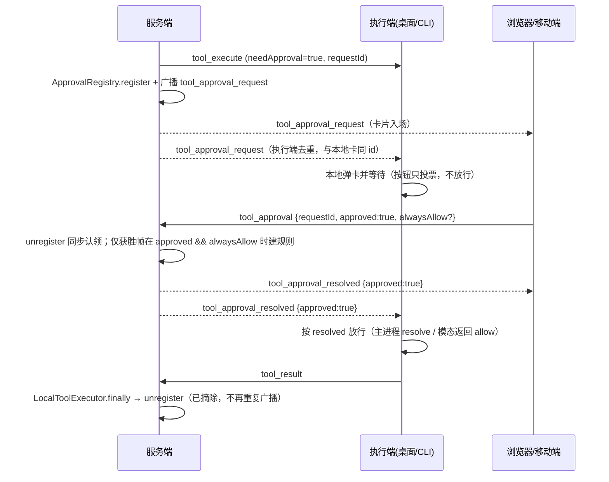

# LOCAL 任务多端审批技术方案（浏览器 / 移动端可审批本机工具调用）

- 状态：**已评审确认**（2026-11-06 两轮复审修订：投票与放行分离、规则创建纳入认领、广播参数截断、`connected` 能力位与回声兜底，见 §11。**本轮不进入功能开发**）
- 关联方案（前置基建，已落地）：
  - [2026-11-05-local-task-device-delegation-technical-design.md](./2026-11-05-local-task-device-delegation-technical-design.md)：LOCAL 会话创建时绑定执行端设备（`session.target_device_id / target_device_name`）、`sendToDevice` 定向投递、浏览器可接管已有 LOCAL 会话的对话。**本方案完全建立在这套设备维度之上，不新增执行模式、不改委托通道。**
  - [2026-06-25-ask-user-questions-design.md](./2026-06-25-ask-user-questions-design.md)：`ask_user_questions` 的跨端「广播 + 先到先得 + 订阅重放 + 取消撤卡」形态，是本方案要对齐的既有范式。
- 相关既有实现（撰写时已核实）：
  - 服务端注册表：`backend-ts/src/harness/approval/approval-registry.ts`（`register` / `unregister` / `takeHint` / `has` / `countForSession`）
  - 审批登记点：`backend-ts/src/harness/local/local-tool-executor.ts`（`sendToolRequest` → `approvalRegistry.register` → 收件箱待办 → 3 分钟升级提醒 → `Promise.race(future, 900s)`，`finally` 统一 `unregister`）
  - 决策入口：`backend-ts/src/session/ws/streaming-ws-handler.ts` 的 `handleToolApproval`（`~1135`）与分发 `case 'tool_approval'`（`~560`）
  - 订阅重放先例：同文件 `handleSubscribe`（`~611-620`，`ask_user_questions` 的 pending 重放）
  - 广播/定向投递：`backend-ts/src/session/ws/streaming-ws-registry.ts` 的 `send(userId, event)`（该用户全部连接）、`sendToDevice` / `getDeviceExecutorSocket` / `hasDeviceConnection`
  - 桌面端：`desktop/electron/main.cjs` 的 `requestToolApproval`（`~719`）与 `ipcMain.handle('tool-approval-response')`（`~742`）、`desktop/electron/preload.cjs`、`desktop/src/composables/useChat.ts` 的 `pendingApprovals` / `ensureApprovalListener` / `confirmApproval`、`desktop/src/composables/useStreamWS.ts` 的 `routeEvent` / `sendToolApproval`
  - 审批卡片：`desktop/src/components/chat/ApprovalStack.vue`（拒绝 / 总是允许 / 执行，`handledIds` 防重复），已在 `ChatPanel`、`SideChatPanel`、`SubagentChatPanel` 三处使用
  - CLI：`agent-cli/src/local/executor.ts`（`ask` / `approveShellText`，多处 `sendReliable({type:'tool_approval', ...})`）、`agent-cli/src/tui/ink-renderer.ts`（`requestApproval` + `modalQueue`，`ask` 的 `setAskResolver` / `deliverAsk` 缓冲范式）、`agent-cli/src/tui/modal-controller.ts`（`ApprovalController`）
- 一句话：LOCAL 工具需要审批时，**服务端把审批请求广播给该用户的所有在线端**，任意一端的按钮只提交投票，服务端**先到先得**认领后广播「已处理」，**执行端只按这一份决策放行或拒绝**。

## 0. 名词约定

| 名词 | 含义 |
|---|---|
| 执行端 / 设备 | 真正执行 LOCAL 工具调用的客户端：桌面 Electron、`mao-agent` CLI。由会话的 `targetDeviceId` 指定（2026-11-05 方案） |
| 审批端 | 收到审批卡、可以点「执行 / 拒绝 / 总是允许」的任意在线端：桌面、浏览器、移动端 Web、CLI TUI |
| 审批请求 | 一条具体的待审批工具调用，主键是服务端 `tool_execute` 下发的 `requestId`（`randomUUID`） |
| 决策 | `approved: true/false` + 是否 `alwaysAllow`；由审批端产生 |
| 投票 | 审批端按钮（或 CLI 按键）只上行 `tool_approval`，此刻不放行工具 |
| 放行 | 执行端收到 `tool_approval_resolved` 后才 resolve IPC Promise / 返回 `ApprovalChoice` |
| 认领（claim） | 服务端对同一 `requestId` 只接受第一个决策；认领在 `unregister` 的第一次 `await` 之前同步完成，后续决策一律忽略 |

## 1. 需求背景

### 1.1 现状

| 能力 | 现状 | 证据 |
|---|---|---|
| 审批卡在哪里出现 | **只在执行端本机**：Electron 主进程 `requestToolApproval` 发 `tool-approval-request` IPC，渲染层 `pendingApprovals` 收下并渲染 `ApprovalStack`；CLI 走 Ink `requestApproval` 弹模态 | `main.cjs:719`、`useChat.ts:54-80`、`ink-renderer.ts:604` |
| 浏览器 / 移动端 | `ensureApprovalListener()` 首行 `if (!window.electronAPI) return`——**浏览器拿不到任何审批事件**，页面上没有任何可点的卡 | `useChat.ts:55` |
| 服务端掌握的信息 | 只登记「这个会话有 N 条审批挂着」：`ApprovalRegistry.pending` 存 `sessionId → Set<requestId>`，`hints` 存「总是允许」模式；**不存工具名、参数、危险原因、设备** | `approval-registry.ts:9-11`、`register()` |
| 服务端登记后的动作 | `enterWaitingApproval` + 广播 `session_status / session_list_update (WAITING_APPROVAL)`；站内收件箱待办；3 分钟无人处理升级提醒 | `approval-registry.ts:29-40`、`local-tool-executor.ts:60-85` |
| 决策上行帧 | 已存在：`{type:'tool_approval', sessionId, requestId, approved?, alwaysAllow?}`。桌面 `confirmApproval` 已带 `approved`；**CLI 不带**（只表示「人已经表态」） | `useStreamWS.ts:592-601`、`agent-cli/src/local/executor.ts:157/172/179/268/274/280` |
| 服务端收到决策后 | 只在 `alwaysAllow===true && approved===true` 时 `takeHint` + 建会话规则；然后 `unregister` + 树信号刷新 + 抑制升级提醒。**不向执行端下发任何东西，也不通知其他端** | `streaming-ws-handler.ts:1135-1162` |
| 跨端广播能力 | 已有：`registry.send(userId, event)` 把帧投给该用户**全部**连接（`ask_user_questions` 就靠它广播、并按 `requestId` 先到先得） | `streaming-ws-registry.ts` 的 `deliver()` `ALL` 分支、`streaming-ws-handler.ts:1193-1212` |
| 订阅重放能力 | 已有：`handleSubscribe` 在会话活跃时重放 `ask_user_questions` 的 pending 列表 | `streaming-ws-handler.ts:611-620` |
| 设备维度 | 已有：会话绑定 `targetDeviceId/Name`、`resolveTarget(sessionId)`、`sendToDevice`、设备断线 `failAllForSocket/Device` | 2026-11-05 方案与实现 |
| 生命周期清理 | 单一收敛点：`LocalToolExecutor.finally` 必调 `unregister`（覆盖批准 / 拒绝 / 结果返回 / 900s 超时 / 断连 / 执行异常） | `local-tool-executor.ts:96-125` |

### 1.2 问题

以用户截图场景为例：Mac 上用 `mao-agent` 创建本地任务，人在浏览器 / 手机上继续对话，Agent 触发一个需要审批的 `shell` 调用——

1. **审批请求到不了浏览器 / 移动端**：服务端从未把「审批内容 + requestId」发出去，前端也没有监听入口；用户只能看到会话处于「等待审批」，看不到任何可操作的卡片。
2. **即使点了也没用**：假设前端硬发一帧 `tool_approval`，服务端只会把 pending 摘掉（连「总是允许」规则都可能被建），但**不会把决策送回执行端**——Mac 上的 CLI 仍停在模态里等键盘输入，任务照样卡住。这正是「必须回到 Mac 点」的根因。
3. **反向也不一致**：在 Mac 上点了之后，其他端没有「已处理」信号，卡片（若存在）与计数只能等下次刷新；多端并发时也没有任何仲裁语义（谁先谁后、重复点击怎么办）。

### 1.3 机会

- `ask_user_questions` 已经把「多端广播 + 先到先得 + 订阅重放 + 取消撤卡」跑通，审批需要的骨架是同一套，**不需要新造通道**。
- `tool_approval` 上行帧、`ApprovalStack` 卡片组件（含三按钮与 hint 文案）、`pendingApprovalCount` 计数链路、`sendToDevice` 定向通道、`resolveTarget` 设备解析**全部已存在**。
- 审批的 pending 生命周期本来就有一个唯一的收敛点（`unregister`），把「撤卡广播」挂在这里即可覆盖决策 / 超时 / 断连 / 异常全部路径，不需要新增清理分支。

## 2. 需求描述

### 2.1 要做的

1. **P1-1 审批请求跨端可达**：LOCAL 工具需要审批时，服务端向该用户**所有在线连接**广播 `tool_approval_request`，载荷包含 `requestId / toolName / arguments / argumentsTruncated? / workspace / dangerReason / approvalHint / deviceName`；`arguments` 超过 8 KiB 时截断。各端复用 `ApprovalStack` 渲染，按 `requestId` 去重（执行端 IPC 卡片与 WS 卡片是同一张）。
2. **P1-2 任意端都能决策**：所有端都提供「执行 / 拒绝 / 总是允许（有 hint 时）」三个动作，与桌面现有卡片行为一致；浏览器 / 移动端不再有本地 IPC 依赖。按钮只投票。
3. **P1-3 决策必达执行端**：服务端认定某个决策后，广播 `tool_approval_resolved`；执行端**只根据这份回声**解除 `requestToolApproval` Promise 或 Ink 模态。本机按钮在回声到达前不放行——**人不必回到执行端，两端同时点也不会各跑一遍**。服务端未声明 `approvalRelay` 能力位（旧后端）时按 §4.5-4 本地放行。
4. **P1-4 多端一致**：任意端决策后，所有端移除该卡片并递减会话待审批计数；执行端本地投出的票同样要等服务端认领成功才撤卡、才放行。
5. **P1-5 幂等与迟到处理**：同一 `requestId` 只有第一个决策生效；重复 / 迟到帧、超时后到达的帧、非 pending 的帧一律忽略。会话规则只由**认领成功且 `approved === true && alwaysAllow === true`** 的那一帧创建。
6. **P1-6 重放**：新打开 / 重连的端订阅会话时，补发该会话当前所有待审批请求（镜像 `ask_user_questions` 的既有做法）。
7. **P1-7 兼容**：旧桌面端 / 旧 CLI 不认识新事件时按未知帧忽略（现状 `default: break`），不报错；旧 CLI 上行帧不带 `approved` 时按「仅通知已处理」处理，不参与决策中继；新客户端连旧后端时按 `connected` 能力位走本地放行，不会等一个永远不会来的回声。
8. **P1-8 文档同步**：根 `CHANGELOG.md`、`skills/mao-cli/` 的桌面 / Web / CLI 使用说明补充「多端审批」段落。

### 2.2 不做的（本期明确排除）

- **不做手机端系统推送 / 任何离线提醒**（用户已明确点名不加；离线端不产生卡片，回到页面靠订阅重放补齐）。
- **不做全局弹窗 / 铃铛 / 桌面通知 / 审批中心**：卡片仍只在会话内（`ChatPanel`、`SideChatPanel`、`SubagentChatPanel`）展示；其它页面只能通过会话列表的待审批徽标感知。
- **不做审批转交 / 指定审批人 / 多人会签**：同一账号的所有端地位平等，先到先得。
- **不做跨用户审批**：会话归属校验沿用 `requireOwnedSession`，审批内容只广播给会话 owner 自己的连接。
- **不做审计 / 管理后台视图 / 操作留痕新增**。
- **不改审批引擎与策略**：是否需要审批仍由 `shouldRequireApproval(permissionLevel)` 与审批规则决定；900s 超时、3 分钟升级提醒、站内收件箱待办口径全部不动。
- **不做非 TTY / 打印模式 CLI 的人工审批**：现状即「需要审批但无法交互 → 直接拒绝」（`evaluateApproval` 的 `canPrompt` 分支），本方案不改变该语义；此类设备收到卡片后会在数毫秒内被 `resolved` 撤掉（见 §7 风险）。
- **不落库**：审批公告只在服务端内存（与 `pending` 同生命周期），不新增表 / 迁移。

## 3. 关键决策（已定案）

| # | 决策点 | 拟定 | 理由与取舍 |
|---|---|---|---|
| D1 | 拓扑 | **服务端中转**：客户端只与服务端通信，不做端到端直连 / 内网穿透 | 执行端本来只连服务端；手机与 Mac 通常在两个网络。中转不需要新端口、新证书、新配对流程 |
| D2 | 广播范围 | `registry.send(userId, event)`：该用户**全部连接**（含执行端自己、浏览器、移动端、CLI） | 用户已定「所有在线端都收到审批卡」；按订阅过滤会漏掉刚打开还没订阅的端，且 `ask_user_questions` 已是全量广播 |
| D3 | 事件协议 | 新增 2 个下行事件 `tool_approval_request` / `tool_approval_resolved`；**决策上行复用既有 `tool_approval` 帧**（补 `approved`） | 复用上行帧不需要新入口与新的鉴权分支；下行拆成两个事件是因为语义不同（入场 vs 撤卡/解除等待） |
| D4 | 并发仲裁 | 服务端**先到先得**。`has()` 只是快路径。真正的认领是 `unregister()` 在**任何 `await` 之前**同步 `ids.delete`，并只把 hint 交给这次删除成功的调用方。只有这次调用能建规则、广播 `resolved`、刷新树信号、抑制升级 | `has()` 挡不住两个已经进入处理函数的帧。规则若在认领前创建，拒绝帧先摘掉 pending 时，「总是允许」帧仍会留下会话规则。与 `ask_user_questions` 的 `complete()` 返回布尔同一语义，但建规则必须包在认领结果里面 |
| D5 | 执行端是否保留本地审批 | **保留本地卡片，按钮只投票**：IPC / TUI 继续弹卡，与 WS 卡按 `requestId` 去重。点击 / 按键只发 `tool_approval`，放行只认 `tool_approval_resolved`（细则 §4.5） | 卡片去重解决不了「Mac 的 IPC 已经 resolve、手机的拒绝才到服务端」。不把「执行端不再弹卡」做成重构，也不改 `requestToolApproval` 的各个调用点与 shell 每动作复检。离线 / 旧后端走 §4.5 的回退，避免本机审批被新客户端挂死 |
| D6 | 决策如何抵达执行端 | **广播 `tool_approval_resolved` 即为送达，也是唯一放行信号**（不再单独做 `sendToDevice` 定向中继） | 执行端的 WS 连接就在渲染层 / CLI 进程里；广播同时完成撤卡与解除等待。定向发送反而要实现两套路径。帧加入 `CRITICAL_EVENT_TYPES`，不受增量队列容量影响 |
| D7 | 决策早到（竞态） | 两端各做**早到缓冲**：Electron 主进程 `earlyApprovalDecisions`（`requestId → decision`，TTL 10 分钟 / 上限 100 条）；CLI Ink `approvalPending`（复用 `askPending` 的既有范式）。已经按本地回退放行过的 `requestId` 不再写入缓冲 | 决策可能早于执行端本地弹卡。不缓冲就会「手机点了、Mac 没反应」。已放行的 id 若再写入缓冲，会把迟到的相反决策套到同 id 的下一次等待上 |
| D8 | 重放 | `handleSubscribe` 的 `active` 分支补 `approvalRegistry.getPendingForSession(sessionId)`，逐条重发 `tool_approval_request` | 与 `ask_user_questions` 完全同构；重连 / 新开标签页都能补卡 |
| D9 | 撤卡清理点 | 只在 `ApprovalRegistry.unregister()` 内广播 `tool_approval_resolved`（覆盖决策 / 900s 超时 / 断连 / 执行异常 / 会话中止） | `LocalToolExecutor.finally` 已经保证必调；`handleToolApproval` 也调同一方法，天然幂等，不新增第二处清理逻辑 |
| D10 | `resolved` 语义 | `approved: true \| false \| null`。`true` / `false` 是人工决策，正在等待的 IPC Promise / 模态必须照它放行或拒绝。`null` = 没有人工决策（超时 / 断连 / 执行异常 / 不带 `approved` 的通知）：有活动等待时按拒绝关闭。没有活动等待时，CLI **不**写入 `approvalPending`（策略自动允许的回声不能变成下一次提问的拒绝）；Electron 写入早到拒绝，避免服务端已收场、本地还没走到 `requestToolApproval` 时弹出一张无法结束的卡 | 两端对「没有人在等」的处理不同，是因为 CLI 有「不提问直接放行」的策略路径，Electron 没有 |
| D11 | 「总是允许」 | 规则仍只由**服务端**生成，且只在 D4 的获胜帧上生成；CLI 收到 `resolved.alwaysAllow` 时额外调用 `recordAlwaysAllow` 记本进程策略（只为当前进程内后续动作不再追问） | 客户端不能注入 pattern（V135 既有约束）；服务端规则生效后下一轮 `needApproval=false`，与端无关。认领失败的「总是允许」不得建规则 |
| D12 | 卡片展示字段 | 服务端下发 `toolName + arguments + workspace + dangerReason + approvalHint + deviceName`。`arguments` 为原始 JSON 字符串，**广播与内存公告最长 8192 字节**，超出则截断并带 `argumentsTruncated: true`。前端能 `JSON.parse` 时用 `getToolInputPreview`（顺带补 `shell` 的 `write_stdin`：取 `input` 而非 `command`）；解析失败时展示截断原文，并注明参数过长已截断 | 服务端不重复实现一套「描述生成」。`write_file` / `edit_file` 的全文只留在发给执行端的 `tool_execute` 里，不进所有在线连接。执行端本地卡仍以 IPC 描述为准（D5） |
| D13 | 旧端兼容 | 旧执行端不认识 `tool_approval_resolved` → 远端决策对它无效，仍需本地点击（功能不减、不报错）；旧 CLI 的上行帧无 `approved` → 服务端只当「已处理通知」，广播 `resolved(null)` 并**不**创建规则。新客户端连旧后端时按 `connected` 能力位判定（无 `approvalRelay` → 立即本地放行），本机审批仍能完成 | 与「先部署后端再部署客户端」的发布顺序配合（§9）；不做事件级的协议嗅探。能力位跟连接重置，回滚 / 蓝绿切换不会让客户端永久等回声 |
| D14 | 状态存储 | 审批公告与现有 `pending` 一样放**单实例内存**，服务重启即丢 | 与现状 pending / 升级提醒一致；重启后本地工具等待本就无法延续（由崩溃恢复链路处理），不引入持久化成本 |

## 4. 协议与数据结构

### 4.1 WS 事件

| 事件 | 方向 | 投递目标 | 载荷（`data`） | 说明 |
|---|---|---|---|---|
| `tool_approval_request` | 服务端 → 客户端 | 该用户全部连接 | `{ requestId, toolName, arguments, argumentsTruncated?, workspace, dangerReason?, approvalHint?, deviceName? }` | 审批入场：渲染卡片。`arguments` 为 JSON 字符串，最长 8192 字节；更长时截断并置 `argumentsTruncated: true`。`sessionId` 在帧顶层（`wsEvent` 既有形态）。加入 `CRITICAL_EVENT_TYPES` |
| `tool_approval_resolved` | 服务端 → 客户端 | 该用户全部连接 | `{ requestId, approved: boolean \| null, alwaysAllow?: boolean }` | 撤卡；对**正在等待**的执行端，这是唯一放行信号。`approved===null` 表示无人工决策。加入 `CRITICAL_EVENT_TYPES` |
| `tool_approval`（**既有**，不新增） | 客户端 → 服务端 | — | `{ sessionId, requestId, approved?, alwaysAllow? }` | 投票（带 `approved`）或「已处理通知」（不带）；`alwaysAllow` 仅 `approved===true` 时有意义。发出此帧不等于放行 |
| `connected`（**既有**，扩字段） | 服务端 → 客户端 | 单连接（`sendToConnection`） | `{ userId, approvalRelay: true }` | 能力协商：本服务端支持审批广播 + 回声放行。旧后端不带该字段，客户端按 `false` 处理；客户端每次 `connected`（含重连）重新判定 |

`arguments` 与 `tool_execute` 的 `argumentsJson` 同源，截断前是同一份字符串。执行端收到的 `tool_execute` 仍是全文，审批广播与内存公告只保留截断后的副本。常量：`APPROVAL_ARGUMENTS_BROADCAST_LIMIT = 8192`。

**能力位为什么放在 `connected`**：不用「见过某个新事件」推断新旧后端——那个标记会跨重连粘滞，一旦发版后回滚（或蓝绿期间连回旧实例），客户端会一直等一个永远不会来的回声，本机审批全部卡到 900s 超时。`connected` 是每次连接必发的握手帧，天然跟着连接重置；旧后端没有该字段即视为不支持，客户端直接走本地放行。

### 4.2 服务端待审批公告（内存）

`ApprovalRegistry` 在既有 `pending / hints` 之外新增公告表（key 同 `hints`：`` `${sessionId}:${requestId}` ``）：

```ts
interface ApprovalAnnouncement {
  requestId: string;
  sessionId: number;
  userId: number | null;        // 广播目标；SUBAGENT 回退父会话
  deviceId: string | null;      // 会话绑定执行端（展示用，可为空 = 未绑定旧会话）
  deviceName: string | null;    // session.target_device_name 快照
  toolName: string;
  arguments: string;            // 已按 8192 字节截断的 JSON 字符串
  argumentsTruncated: boolean;
  workspace: string;
  dangerReason: string | null;
  approvalHint: ApprovalHint | null;
  announcedAt: number;
}
```

- `register()` 先截断 `arguments`，再写入公告并广播 `tool_approval_request`。内存里不保留全文。
- `unregister()` 在第一次 `await` 之前同步摘除 pending、取出并删除 hint、删除公告。只有摘除成功才广播 `tool_approval_resolved`，并把 hint 返回给调用方。
- **广播时序**：`resolved` 放在既有相位恢复（`restoreRunningAfterApproval` / `publishPhase('RUNNING')`）之后发出——执行端收到回声会立刻继续执行并回传 `tool_result`，此时会话相位应已从 `WAITING_APPROVAL` 恢复（`handleToolResult` 目前不做相位校验，这条只是把顺序摆正）。
- **近期结果缓存** `recentResolutions: Map<string, { approved: boolean | null; alwaysAllow: boolean; at: number }>`：认领成功时写入（TTL 10 分钟、上限 200，写入时惰性清理）。用途见 §4.5-6：客户端重发投票时补发一次回声，覆盖「投票帧丢 / 回声帧丢」。
- `getPendingForSession(sessionId)` 供订阅重放（返回已截断的 payload 数组，屏蔽内部结构）。
- 拿不到 `userId`（会话无归属等异常）时只保留本地行为，不广播。
- 重发 / 覆盖：同 `requestId` 重复 `register` 不重复广播（已存在则仅更新字段）。

### 4.3 前端 `ApprovalItem` 扩展（desktop 与 Web 共用）

```ts
interface ApprovalItem {
  requestId: string
  toolName: string
  description: string
  sessionId?: string
  dangerReason?: string
  approvalHint?: ApprovalHint
  // 新增
  source?: 'local' | 'remote'   // local = Electron IPC；remote = WS 广播
  deviceName?: string            // 远端卡片展示「在 xxx 上执行」
}
```

- 队列按 `requestId` **upsert**：`local` 到达时覆盖同 id 的 `description`（主进程口径更精确），`remote` 只在不存在时插入。
- 计数：`sessionStore.incrementPendingApproval / decrementPendingApproval` 只在「新插入 / 真移除」时调用，避免双通道重复计数。

### 4.4 时序（主链路）



（等价文字版：登记即广播 → 任意端只投票 → 服务端同步认领并只让获胜帧建规则 → 广播 resolved → 执行端按回声放行 → 工具继续执行 → 结果回传。执行端自己点按钮时同样先上行、再等同一条回声，不另开一条放行路径。）

### 4.5 执行端放行（投票与放行分离）

人工审批的放行权只在服务端认领之后。执行端本地卡片继续存在，但点击 / 按键不再直接 resolve。

1. **投票。** 按钮上行 `tool_approval`（带 `approved`，需要时带 `alwaysAllow`）。卡片用现有 `handledIds` 防重复；同时把 `requestId` 记入队列模块的 `votedIds`，直到该 id 收到 `resolved` 才清除——否则「投完票后晚到的 IPC 本地卡」或「重新订阅的重放」会把同一张卡插回来、还能再点一次。上行失败时把卡片放回原位并清除 `votedIds`。
2. **能力判定只看连接。** 客户端在 `case 'connected'` → `handleAuthenticated(data)` 里按**本次连接**写入 `approvalRelaySupported = data?.approvalRelay === true`；每次 `connected`（含重连）都重新判定。旧后端不带该字段即 `false`。不再使用「见过某个事件」的模块级标记，也不做 800ms 猜测。
3. **支持中继（`approvalRelay === true`）。** 放行只认本 `requestId` 的 `resolved`：`approved === true` 放行，否则拒绝。投票后把 `requestId → { sessionId, approved, alwaysAllow, attempts }` 记入 `awaitingEcho`（供重发与无主回收），`resolved` 到达时移除。
4. **不支持中继（旧后端）。** 上行发送成功后**立即**按本地选择放行：先把 `requestId` 记入 `locallyReleased`，再走解锁入口，不等任何回声——旧后端本来就不会回。这是「新客户端 + 旧后端」的唯一兼容路径，也是回滚安全的保证（不需要 800ms 宽限，也就不会被慢链路误判）。
5. **上行发送失败（本机到服务端的连接已断）。** 立即按本地选择放行。这是单机离线，没有第二端可以抢认领。
6. **投票帧 / 回声帧丢失的兜底（仅支持中继时）。**
   - 投票后 5s 仍未收到 `resolved` 且连接仍在线 → **重发一次同一帧**（最多 2 次；重连成功后立即补发一次）。
   - 服务端对已认领的 `requestId` 保留 `recentResolutions`（§4.2）：收到非 pending 的 `tool_approval` 时，命中缓存就**只对发起帧的连接**回发一次 `tool_approval_resolved`，结果以缓存为准（重发不会改变已生效的决策）；未命中则按迟到帧忽略。
   - 这一步同时覆盖「投票帧丢」（服务端从没收到票）和「回声帧丢」（票已认领、客户端没收到结果）两种单向丢失，避免把会话拖到 900s 超时。
7. **等待的无主回收。** `awaitingEcho` 里的记录在以下情况按拒绝释放（不再等回声）：该会话进入终态（`session_status` / `session_snapshot` 的 COMPLETED / FAILED / CANCELLED）、该会话的卡片被 `clearPendingApprovals(sessionId)` 清空。此时本轮执行已经结束或用户已离开，继续等没有意义。
8. **策略自动允许 / 拒绝（无人参与，上行不带 `approved`）。** 不进入上述等待。CLI 维持今天的语义：判定后立即执行或拒绝，并发送「已处理通知」。随后到达的 `resolved(null)` 在没有活动等待时只撤其他端的卡。
9. **`resolved(null)` 且模态 / Promise 仍在等。** 按拒绝结束等待（超时、断连、执行异常）。
10. **主进程只有一个解锁入口**（`tool-approval-remote-response`）：`pendingApprovals` 命中则 resolve；未命中则写入 `earlyApprovalDecisions`。它不读取 `locallyReleased`。`requestToolApproval` 创建 Promise 前先查缓冲，命中则直接 resolve、不弹卡。谁可以调用这个入口，由渲染层用 `locallyReleased` 决定。

切走会话时的清理见 §5.2：Electron 对清掉的每个 `requestId` 走这个解锁入口并传入拒绝，不看卡片 `source`，也不补发 `tool_approval`。

## 5. 实现步骤

### 5.1 后端（backend-ts）

1. **`harness/approval/approval-registry.ts` 扩为多端审批中枢**
   - 新增 `announcements: Map<string, ApprovalAnnouncement>`；`register(sessionId, requestId, hint?, context?)`：`context = { toolName, arguments, workspace, dangerReason }`，由调用方（`LocalToolExecutor`）组装；`userId / deviceId / deviceName` 由注册表内部解析（见下）。
   - 广播实现：`sessionMapper.selectById(sessionId)` 拿 `userId / targetDeviceId / targetDeviceName`（`userId` 为空且是 SUBAGENT 时回退父会话——与 `LocalToolSessionRegistry.resolveUserId` 同口径）；`streamingWsRegistry.send(userId, wsEvent('tool_approval_request', sessionId, payload))`。
   - `register` 写公告前把 `arguments` 截到 8192 字节并设置 `argumentsTruncated`。**截断实现注意**：用 `Buffer.byteLength` 判长、按码点安全切（不要用 `Buffer.slice` 直接切，会把多字节字符切成替换符）；截断标记随公告 / 广播 / 重放一起下发，前端据此在描述尾部注「参数过长已截断」。`hints.set` 后若公告已存在（同 requestId 重发）→ 只更新、不重播。
   - `unregister(sessionId, requestId, decision?)` 返回 `{ removed: boolean, hint: ApprovalHint | null }`。在任何 `await` 之前完成：`ids.delete`、仅当删除成功时取出并删除 hint、删除公告、写入 `recentResolutions`（同步落缓存，避免并发帧查不到刚认领的结果）。`removed === false` 时 hint 必须是 `null`，且不广播。`removed === true` 时：先走既有相位恢复（`restoreRunningAfterApproval` / `publishPhase('RUNNING')`），**再**广播 `tool_approval_resolved`：`decision` 带了布尔 `approved` 就带 `{ approved, alwaysAllow }`，没传（超时 / 断连 / 异常 / 不带 `approved` 的通知）带 `{ approved: null }`。
   - 新增 `getRecentResolution(sessionId, requestId): { approved: boolean | null; alwaysAllow: boolean } | null`（供重发投票补发回声，见第 3 点）。
   - 提供 `getPendingForSession(sessionId): ApprovalRequestPayload[]`（已截断）。
   - `has()` 保持不变，只做快路径。`takeHint` 不再由 `handleToolApproval` 在认领前调用；hint 只从获胜的 `unregister` 返回值里拿。原 `takeHint` 可留给测试或删掉调用点，但超时路径仍必须把 hint 删掉，避免陈旧帧建规则。
2. **`harness/local/local-tool-executor.ts` 传上下文**
   - 在 `approvalRegistry.register(sessionId, pending.requestId, hint, { toolName, arguments: argumentsJson, workspace, dangerReason })` 增加第 4 参；其余顺序（树信号 → 收件箱 → 升级提醒）与 `finally` 不动。
   - 依赖接口（spec 桩）同步扩：`register(…, context?)`、`getPendingForSession?`，缺省桩返回空。
3. **`session/ws/streaming-ws-handler.ts` 的 `handleToolApproval`**
   - 分发处改成传连接：`case 'tool_approval': await this.handleToolApproval(session, userId, root); break;`（补发回声要用 `sendToConnection`）。
   - 入口可先 `has()`，没有 pending 就走**补发分支**：`const recent = approvalRegistry.getRecentResolution(sessionId, requestId)`，命中则 `registry.sendToConnection(session, wsEvent('tool_approval_resolved', sessionId, {...recent}))` 后返回；未命中按迟到帧直接返回（不建规则、不刷树、不抑制）。
   - 仍有 pending 时：`const claim = await approvalRegistry.unregister(sessionId, requestId, typeof root.approved === 'boolean' ? { approved: root.approved, alwaysAllow: root.alwaysAllow === true } : undefined)`。`claim.removed === false` 时兜底走一次上面的补发分支再返回。
   - **仅当 `claim.removed && root.approved === true && root.alwaysAllow === true && claim.hint`** 时 `createSessionRuleFromAlwaysAllow`。拒绝帧获胜、或不带 `approved` 的通知获胜，都不得建规则。并发的「总是允许」帧如果输了认领，拿不到 hint。
   - 规则创建之后（仍只在 `removed` 时）执行 `treeSignalPublisher.publishForSession` + `approvalEscalationSuppressor.suppressByRequest`。
   - deps 类型更新：`approvalRegistry: { unregister(...); has?; getPendingForSession?; getRecentResolution?; register? }`（保持可选，旧测试桩不受影响）。`takeHint` 从这条路径的依赖里拿掉。
4. **`handleSubscribe` 重放**（`~611-620` 的 `if (active)` 块内）
   - 在 `ask_user_questions` 重放之后补：`for (const a of this.deps.approvalRegistry.getPendingForSession?.(sessionId) ?? []) this.deps.registry.send(userId, wsEvent('tool_approval_request', sessionId, a));`（与提问重放同粒度、同广播方式，客户端按 `requestId` 去重）。
5. **`session/ws/streaming-ws-registry.ts`**
   - `CRITICAL_EVENT_TYPES` 增加 `'tool_approval_request'` 与 `'tool_approval_resolved'`（丢帧会导致卡片 / 等待永久悬挂，与 `ask_user_questions` 同级）。
   - 无其它改动（`send` / `sendToDevice` 复用）。
6. **`connected` 帧能力位**（`streaming-ws-handler.ts:530`）
   - `wsEvent('connected', null, { userId: metadata.userId, approvalRelay: true })`。旧客户端忽略未知字段；旧后端不发该字段，新客户端按 `false` 处理（§4.5-4）。
7. **测试桩与既有 spec 适配**：`local-tool-executor.spec.ts` 断言 `register` 第 4 参；`approval-registry.spec.ts` 补公告、截断、`recentResolutions` 与广播断言（见 §8）。

### 5.2 桌面端（Electron + Web 共用同一 dist）

1. **抽独立审批队列模块**（新文件 `desktop/src/composables/approvalQueue.ts`）
   - 把 `useChat.ts` 里模块级的 `pendingApprovals` + 增删逻辑迁出，提供 `upsertApproval(item)`、`removeApproval(requestId)`、`useApprovalQueue()`；**避免 `useStreamWS → useChat` 的循环依赖**（现 `useChat` 已在函数内惰性调 `useStreamWS`，反向 import 只能靠抽模块解决）。
   - 同模块持有放行状态：`approvalRelaySupported`（按连接重置）、`votedIds`（投票防复活）、`awaitingEcho`（`requestId → { sessionId, approved, alwaysAllow, attempts }`，供重发与无主回收）、`locallyReleased`（旧后端本地放行标记）。
2. **`useChat.ts` 接入**
   - `ensureApprovalListener`（仅 Electron）改为调 `upsertApproval({ source: 'local', ... })`；`onToolApprovalDismiss` → `removeApproval`。`source` 只用于描述覆盖和计数，不参与放行；`upsertApproval` 命中 `votedIds` 时直接丢弃（防「投票后 IPC 卡晚到」复活）。
   - `confirmApproval` 改为投票：从队列移除卡片并记入 `votedIds` → **不调** `respondToolApproval` → `sendToolApproval`。发送失败则把卡片放回、清 `votedIds` 并报错。
   - 发送成功后按 §4.5 分流：`approvalRelaySupported === false`（旧后端）→ 记 `locallyReleased` + `respondToolApprovalRemote(requestId, approved, alwaysAllow)` 立即按本地选择放行；`=== true` → 写入 `awaitingEcho` 等回声，5s 未到且连接在线则重发同一帧（最多 2 次）。
   - `clearPendingApprovals`：Electron 上每个被清掉的 `requestId` 都调 `respondToolApprovalRemote(requestId, false, false)`，**不看 `source`**。主进程没有对应 pending 时写入早到拒绝，避免「WS 卡先到、用户已离开、随后才走到 `requestToolApproval`」把 Promise 挂住。这里不发 `tool_approval`，避免在桌面上看 CLI 任务时一切走会话就替那次执行投出拒绝。同时把该会话在 `awaitingEcho` 里的记录按拒绝释放（§4.5-7）。浏览器上的远端卡只摘 UI。
3. **`useStreamWS.ts` 的 `routeEvent`**
   - `case 'connected'`：`handleAuthenticated(data)` 内按本次连接写 `approvalRelaySupported = data?.approvalRelay === true`；重连成功后对 `awaitingEcho` 的每个 id 立即补发一次投票（`sendToolApproval`，参数取自记录）。
   - `case 'tool_approval_request'`：`argumentsTruncated` 或 `JSON.parse` 失败时，描述用截断原文并在尾部注明「参数过长已截断」；否则 `getToolInputPreview(toolName, parsedArgs) || toolName`。`upsertApproval({ source:'remote', ... })`（命中 `votedIds` 丢弃）；仅新插入时 `incrementPendingApproval`。
   - `case 'tool_approval_resolved'`：`removeApproval(requestId)` + 清 `votedIds` / `awaitingEcho` + `decrement`。Electron 时，该 id 已在 `locallyReleased` 则不再调用主进程；否则**无条件**调 `respondToolApprovalRemote(requestId, approved === true, alwaysAllow === true)`。`approved === null` 因此会拒绝正在等待的 Promise，并在没有 pending 时写入早到拒绝。不做「卡片是否存在」判断，否则决策早到会漏。
   - `case 'session_status'` / `session_snapshot` 的终态相位：把该会话 `awaitingEcho` 里的记录按拒绝释放（§4.5-7），避免回声丢失后主进程永久等待。
   - 两个新事件不加入 `STREAM_EVENT_TYPES`（不带 `executionId`，不需要陈旧过滤）；`connected` 不是流式事件，不受影响。
4. **`preload.cjs` / `main.cjs`**
   - `preload.cjs` 增加 `respondToolApprovalRemote: (requestId, approved, alwaysAllow) => ipcRenderer.invoke('tool-approval-remote-response', { requestId, approved, alwaysAllow })`。投票路径与清理路径都走它。
   - **同时删掉旧的 `respondToolApproval`（`tool-approval-response`）**：修订后它已无调用方（`confirmApproval` 与 `clearPendingApprovals` 都走新入口），留着会让后来人接错、绕过 `locallyReleased` 语义。
   - `main.cjs` 增加 `earlyApprovalDecisions = new Map()`（TTL 10 分钟、上限 100，写入时惰性清理）。`ipcMain.handle('tool-approval-remote-response')`：`pendingApprovals` 命中 → resolve；否则写入早到缓冲。不在主进程保存 `locallyReleased`。
   - `requestToolApproval`：创建 Promise 前先查 `earlyApprovalDecisions`——命中即删除并**直接 resolve，不弹本地卡片**。
5. **卡片 UI（`ApprovalStack.vue` + 面板）**
   - `ApprovalItem` 增 `deviceName?`；卡片标题行右侧加轻量标签「· 在 {deviceName} 上执行（远端）」；无 `deviceName`（执行端本地卡）不显示。按钮 / 防重复 / 展开复制全部复用。
   - 面板过滤逻辑不变（`ChatPanel` 已把「无 sessionId / 本会话 / 本会话子代理」都纳入）。
6. **`toolDisplay.ts` 小修**：`getToolInputPreview` 的兜底分支优先 `input.command`，对 `shell` 的 `write_stdin` 场景应取 `input.input`（服务端下发的参数里 `command` 不存在），补一个显式 case。

### 5.3 终端 CLI（agent-cli）

1. **`local/approval.ts`**：`ApprovalRequest` 增可选 `requestId?: string`（`evaluateApproval / recordAlwaysAllow` 只读 `toolName/description`，不受影响）。
2. **`local/executor.ts`**
   - `onToolExecute` 组装 `req` 时带 `requestId`；`approveShellText` 的 `stepReq` 经扩展保留。
   - 新增 `setApprovalRelaySupported(v: boolean)`：由 `commands/chat.ts` 从 `session-runner` 的能力位同步；缺省 `false`（未连接 / 旧后端）。
   - 上行帧补决策位：
     - 人工 `ask` 路径（非 shell）与 shell 每动作路径：按键后先发投票帧，**模态保持打开**。`approvalRelaySupported === false`（旧后端）→ 记 `locallyReleased` 后立即返回本地选择；`=== true` → 等 `deliverApproval`，5s 未到且连接在线则重发同一帧（最多 2 次，重连成功后立即补发一次）。回声与本地按键不一致时以回声为准。
     - 策略自动 `allow` / `deny`（无人参与）保持**不带** `approved`，判定后立即执行或拒绝，不等待回声。
   - `handleEvent` 增加 `tool_approval_resolved` 分支：`this.opts.onRemoteApprovalDecision?.(requestId, root)`——把决策转给 TUI。**不再维护「见过新事件」标记**：能力判定只在 `connected`（见第 3 点）。
3. **`session/session-runner.ts`**
   - `handleWs` 顶部本来就收到 `connected`：在这里读 `evt.data?.approvalRelay === true` 存为 `this.approvalRelaySupported`（每次 `connected` 覆盖，不跨连接粘滞），并通知 `commands/chat.ts` 同步给 executor / TUI。`connected` 早于 executor 创建时先存字段，创建时读取。
   - 本地转发白名单（`tool_execute / skill_sync_required / mcp_sync_required`）增加 `tool_approval_resolved`；`tool_approval_request` 不进执行器（CLI 不另画 WS 卡）。
   - 结算终态时 emit 新事件 `{ type: 'approval_aborted' }`（在 `flushWaiters` 的终态赋值点统一发一次），供 TUI 关闭所有审批模态；`CliEvent` 联合类型同步扩（`ws/event-types.ts`）。
4. **`tui/ink-renderer.ts`**
   - `requestApproval(req, reason)` 用 `req.requestId` 作 key：先查 `approvalPending`（早到决策）→ 命中直接返回；否则入 `modalQueue` 并登记 `approvalResolvers`。本地按键只把选择交给 executor，不在渲染层 resolve；按键后模态进入「已提交，等待服务端确认…」状态并忽略后续按键（防同一请求重复投票）。
   - 新增 `deliverApproval(requestId, choice | null)`：有活动 resolver → `closeModal` + resolve；`choice === null` 且有活动 resolver → 按 `deny` 关闭（超时 / 中止）。没有活动 resolver 时，只有 `allow` / `always` / `deny` 才写入 `approvalPending`；`null` 不写入。
   - 新增 `abortAllApprovals()`：关闭全部 approval 模态、按 `deny` resolve、清空 `approvalPending`；由 `approval_aborted` 事件触发。
   - 旧后端本地放行（§4.5-4）在 resolve 之前把 `requestId` 记入 `locallyReleased`。此后同 id 的 `deliverApproval` 忽略，不写缓冲。
5. **`commands/chat.ts`**：装配 `onRemoteApprovalDecision`（`approved === true → alwaysAllow ? 'always' : 'allow'`，`false → 'deny'`，`null → null`）；把 `session-runner` 的 `approvalRelaySupported` 变化同步给 `executor.setApprovalRelaySupported` 与 TUI（TUI 用同一值决定按键后是否等回声）；装配 `approval_aborted` → `ink.abortAllApprovals()`。`always` 仍走 executor 既有的 `recordAlwaysAllow`。
6. **打印模式 / 非 TTY**：`askApproval` 未装配（或 `canPrompt=false` 直接拒绝），远端审批不生效——与现状一致，文档写明。

### 5.4 契约与类型

- **contracts 无变更**：新事件是裸字符串 + 无强类型 `data`（与 `tool_execute` / `ask_user_questions` 同级），不触发 contracts 枚举收口规则。
- 服务端内部类型：`ApprovalAnnouncement`（新增，`harness/approval/`）；`ApprovalHint` 复用既有 contracts 类型。
- 前端：`ApprovalItem` 扩展在 `ApprovalStack.vue` 与 `approvalQueue.ts` 内自洽。

### 5.5 文档（随 P1 改动）

- 根 `CHANGELOG.md` 顶部版本小节：后端（审批广播 + 决策中转）、桌面 / Web（任意端可审批 LOCAL 任务）、CLI（可被远端解除审批模态）。
- `skills/mao-cli/`：桌面 / Web / CLI 使用说明的「本地任务 / 审批」段落补充「多端审批」行为与边界（不含系统推送、离线端回到页面后补卡）。

## 6. 落地清单

| 端 / 文档 | 项 |
|---|---|
| backend-ts | `harness/approval/approval-registry.ts`（公告表、参数截断、`register` 广播、`unregister` 同步认领并交出 hint、`resolved` 广播、`recentResolutions`、`getPendingForSession`）、`harness/local/local-tool-executor.ts`（register 第 4 参上下文）、`session/ws/streaming-ws-handler.ts`（认领成功后才建规则；重发投票补发回声；`connected` 能力位；`handleSubscribe` 重放；deps 类型）、`session/ws/streaming-ws-registry.ts`（`CRITICAL_EVENT_TYPES` +2）、相关 spec / 桩 |
| desktop | 新增 `src/composables/approvalQueue.ts`（队列 + `approvalRelaySupported` / `votedIds` / `awaitingEcho` / `locallyReleased`）；`composables/useChat.ts`（投票不放行、按能力位分流、投递失败回滚、清理时一律解锁主进程）、`composables/useStreamWS.ts`（`connected` 能力位、`routeEvent` +2 事件、终态回收 `awaitingEcho`）、`electron/preload.cjs`（新增 `respondToolApprovalRemote`，删旧 `respondToolApproval`）、`electron/main.cjs`（早到缓冲、单一解锁入口）、`components/chat/ApprovalStack.vue`（`deviceName` 展示）、`utils/toolDisplay.ts`（`write_stdin` 预览） |
| agent-cli | `local/approval.ts`（`requestId`）、`local/executor.ts`（人工路径等回声 / 重发、策略路径不等待、`setApprovalRelaySupported`）、`session/session-runner.ts`（`connected` 能力位、转发 `tool_approval_resolved`、终态 emit `approval_aborted`）、`ws/event-types.ts`（`approval_aborted`）、`tui/ink-renderer.ts`（`deliverApproval` / `abortAllApprovals`；`null` 在无模态时不进缓冲）、`commands/chat.ts`（装配回调与能力位同步） |
| contracts | 无变更 |
| 迁移 / 数据库 | 无（审批公告内存态） |
| 测试 | 见 §8 |
| 文档 | 根 `CHANGELOG.md`；`skills/mao-cli/`（桌面 / Web / CLI 审批段落） |

## 7. 风险与回归护栏

| 风险 | 护栏 |
|---|---|
| 执行端出现两张卡（IPC 本地卡 + WS 广播卡） | 队列按 `requestId` upsert；`local` 到达覆盖 `remote` 的 `description`；计数只在插入 / 移除时增减 |
| 决策早于执行端本地弹卡（手机手快 / 广播先到） | Electron 主进程 `earlyApprovalDecisions` 缓冲（命中即 resolve 且不弹卡）；CLI `approvalPending` 缓冲（镜像 `askPending`）。已 `locallyReleased` / 已放行的 id 不再入缓冲 |
| 多端同时点击，本机 IPC 先跑起来 | 人工路径在 `resolved` 之前不放行。服务端同步认领，执行端按获胜的那份 `approved` 执行。旧后端由 `connected` 能力位识别（`approvalRelay !== true`）后立即本地放行，不需要猜测 |
| 拒绝与「总是允许」并发，规则被拒绝方留下 | `unregister` 在 `await` 前摘除 pending 并只把 hint 交给获胜调用。`createSessionRuleFromAlwaysAllow` 放在 `removed && approved && alwaysAllow && hint` 之后。输的帧拿不到 hint |
| 迟到 / 超时后的帧仍能建规则 | 认领失败直接返回；获胜的超时 / 通知路径删除 hint 且不建规则 |
| 设备侧无人可问（非 TTY / `--on-approval=fail` 立即拒绝） | 卡片广播后数毫秒内被 `resolved(null)` 撤掉；UX 上等价于「闪一下」；文档写清此类设备不支持人工审批（现状语义） |
| 旧执行端不认 `tool_approval_resolved` | 远端决策对旧端无效（仍需本地点击），但不会报错、不会卡服务端；发布顺序保证先升级服务端，后升级客户端；CHANGELOG 提示升级桌面 / CLI |
| 旧 CLI 上行帧不带 `approved` | 服务端按「已处理通知」处理：广播 `resolved(null)` 撤卡、不建规则、不中继；不影响其本地执行 |
| 广播帧被增量队列丢弃 | `tool_approval_request / tool_approval_resolved` 加入 `CRITICAL_EVENT_TYPES`（关键队列不受容量限制） |
| 执行中设备断线 | 既有 `failAllForSocket / failAllForDevice` 失败 pending 工具请求；`finally → unregister` 广播 `resolved(null)`，各端卡片清理；会话不悬挂 |
| 服务重启（内存公告丢失） | 与现状 pending 丢失同构：重启后本地工具等待由崩溃恢复链路处理；前端残留卡片会在切换会话 / `clearPendingApprovals` / 下一次重放校正时收敛；已知限制，不做持久化 |
| 卡片出现在「非当前会话」的端上 | 与现状一致：卡片按会话过滤（`ChatPanel` 只显示当前会话及其子代理），会话列表待审批徽标来自 VO 计数；用户打开对应会话即可操作（或不操作，等超时） |
| `alwaysAllow` 被客户端伪造 pattern | 不变：客户端只传布尔位，pattern 由服务端按 `requestId` 取回自己生成的 hint（V135 约束）；无 hint 时按钮不渲染 |
| 广播内容敏感（命令 / 路径 / 文件正文） | 只在会话 owner 自己的连接之间广播（`requireOwnedSession` + `userId` 维度），不跨用户；不落库、不写日志正文。`arguments` 超过 8192 字节只广播前缀，全文仅在 `tool_execute` 发给执行端 |
| WS 卡先到就被标成 `remote`，切走会话后主进程悬挂 | Electron 清理队列时对每个 `requestId` 走解锁入口并传入拒绝，不看 `source`。没有 pending 就写入早到拒绝。不补发 `tool_approval` |
| 执行端本地点击后其他端卡片仍在 | 本地点击只发带 `approved` 的投票 → 服务端认领 → 广播 `resolved` 撤卡，并作为执行端的放行信号 |
| 新客户端连旧后端，本机审批一直等回声 | 能力位不看事件、只看 `connected`：旧后端不带 `approvalRelay` → 客户端立即按本地选择放行。每次重连重新判定，发版后回滚 / 蓝绿切换也不会粘滞 |
| 投票帧或回声帧单向丢失（连接抖动） | 支持中继时投票后 5s 未收到 `resolved` 且连接在线 → 重发一次（最多 2 次，重连后立即补发）；服务端 `recentResolutions` 命中时只对发起连接补发一次回声（结果以缓存为准，重发不改决策）。不再把会话拖到 900s 超时 |
| 卡片投票后被「复活」（IPC 卡晚到 / 重放） | 队列模块 `votedIds`：投票即登记、`resolved` 才清除，`upsertApproval` 命中直接丢弃 |
| `awaitingEcho` 等不到回声又无人处理（页面已离开 / 本轮已结束） | 会话终态、`clearPendingApprovals(sessionId)` 两类触发点按拒绝释放；CLI 在本轮终态（`approval_aborted`）关闭全部审批模态 |
| 策略自动允许的 `resolved(null)` 把下一次 CLI 提问拒绝掉 | CLI 在没有活动 resolver 时不把 `null` 写入 `approvalPending`。策略路径本身不等待回声 |
| 审批与升级提醒 / 收件箱既有口径被改动 | 一律不改：3 分钟升级提醒只在「人还没表态」时发出，`resolved` 即抑制；收件箱待办仍只在 `LocalToolExecutor.finally` 置已读 |
| 「总是允许」在远端点了但规则没生效 | 获胜帧的 `unregister` 回传 hint；hint 缺失（超时 / 重启 / 认领失败）时静默忽略 `alwaysAllow`，仅本次放行。卡片上按钮的可见性由 hint 存在性保证 |

## 8. 测试要点

**后端（`cd backend-ts && npm test`）**

1. `approval-registry.spec.ts`：
   - `register` 写入公告并广播 `tool_approval_request`（载荷含 `toolName / arguments / workspace / deviceName`；无 userId 不广播；同 requestId 重发不重播）；
   - `arguments` 长于 8192 字节时，公告与广播都是前缀且 `argumentsTruncated === true`；短于上限时标记为 false，内容不改；
   - `unregister` 首次 `removed === true`、带回 hint，并广播 `resolved`（带决策 / `null` 两种版式）；第二次 `removed === false`、`hint === null`、不广播；
   - 两次 `unregister` 交错调用时，只有先执行到同步 `ids.delete` 的那次 `removed === true`（用在第一次 `await` 前插入的桩卡住相位恢复来制造交错）；
   - `recentResolutions`：认领成功写入（带决策）；超时 / 未认领不写；超 TTL / 超上限被清理；`getRecentResolution` 命中返回缓存结果；
   - `getPendingForSession` 返回当前挂起公告（已截断）。
2. `local-tool-executor.spec.ts`：`register` 第 4 参上下文齐全；超时 / 异常路径 `finally` 仍触发 `unregister` 且只广播一次（与决策路径互斥）。
3. `streaming-ws-handler.spec.ts`：
   - 决策帧（带 `approved`）→ 广播 `resolved(approved)` + 树信号 + 抑制升级，且规则只建一次；
   - 非 pending 帧（重复 / 迟到）→ 全链路无副作用（不建规则、不广播）；
   - 只有获胜帧在 `approved === true && alwaysAllow === true` 且 hint 存在时建规则；并发的拒绝帧先认领成功时，后到的「总是允许」不建规则；`deny` 永不建规则；
   - `handleSubscribe` 重放：会话活跃且存在 pending 审批 → 补发 `tool_approval_request`（与 `ask_user_questions` 重放同块）；
   - 重发投票：已认领的 `requestId` 再收到一帧（带 `approved`）→ 命中 `recentResolutions` 时只对发起连接补发 `tool_approval_resolved`（`sendToConnection`，不广播），不改决策、不建规则；未命中缓存静默忽略；
   - `connected` 帧：auth 成功后携带 `{ userId, approvalRelay: true }`。
4. `streaming-ws-registry.spec.ts`：两个新事件走关键队列（容量满时不被丢弃、优先冲刷）。
5. **回归**：既有 `tool_approval`（不带 approved，旧 CLI 形态）→ 广播 `resolved(null)`、不中继、不建规则、`WAITING_APPROVAL → RUNNING` 相位恢复不变。

**前端 / CLI**

6. desktop 单测：`approvalQueue` upsert 去重与 `local` 覆盖 `remote` 描述、计数不双增、`votedIds` 命中的插入被丢弃；`confirmApproval` 在 `resolved` 之前不调用 `respondToolApprovalRemote`，回声到达后按回声的 `approved` 调用（与本地按钮相反时以回声为准）；`approvalRelay !== true`（旧后端 / 未声明）时发送成功后立即本地放行且不启动任何计时；支持中继时 5s 未收到回声重发（最多 2 次）、重连后立即补发；`locallyReleased` 之后的迟到回声不再进主进程；会话终态 / `clearPendingApprovals` 释放 `awaitingEcho`（按拒绝调用解锁入口）；`clearPendingApprovals` 对 `source:'remote'` 的项同样调用解锁入口且不发 `tool_approval`；`useStreamWS` 的 `connected` 设置 / 重置 `approvalRelaySupported`、截断参数走「解析失败则展示前缀」；`main.cjs` 早到缓冲（先收到决策 → `requestToolApproval` 直接 resolve 且不弹卡；无 pending 的拒绝写入缓冲；TTL / 容量清理）。
7. `cd desktop && npm run build`（vue-tsc 类型检查）；`cd agent-cli && npm run build && npx vitest run`：`connected` 能力位同步到 executor / TUI；`approvalRelay !== true` 时人工路径按键后立即放行、`=== true` 时等 `deliverApproval`（回声为拒绝时不执行）；5s 重发一次；`tool_approval_resolved` 解析模态；`resolved(null)` 在无模态时不写入 `approvalPending`；本轮终态触发 `abortAllApprovals`（模态全部按拒绝关闭）；策略自动放行 / 拒绝仍不带 `approved` 且不等待。
8. **手工联调（必须）**：
   - Mac 桌面 / CLI 创建 LOCAL 任务 → 手机浏览器打开同一会话 → 触发需审批的 `shell` → **手机上点「执行」→ Mac 无需任何操作直接执行**、结果回传、两端卡片消失；
   - 同一场景手机点「拒绝」→ Mac 本地模态同步拒绝、工具未执行；
   - 同一场景手机点「总是允许」→ 后续同类调用不再触发审批（服务端规则生效），会话详情可见规则；
   - 两端同时点（浏览器执行 + 桌面拒绝，以及反过来）→ 工具只按先到服务端的那一票执行或拒绝，没有「服务端记了拒绝、本机已经跑起来」；
   - 桌面本地先点 → 手机卡片在回声后消失，Mac 在回声之后才执行；
   - 手机刷新页面 / 换新标签页订阅 → 卡片由重放恢复；
   - 执行端 CLI 模态在等待时被远端决策解除（无需在终端按键）；本机按键与远端相反时以远端为准；
   - 设备掉线：审批卡出现后杀掉执行端 → 各端卡片清理、工具调用失败收敛（不悬挂）；
   - 超时路径：900s 内无人处理 → 各端卡片清理（`resolved(null)`）、CLI 模态关闭；
   - 超长 `write_file`：手机卡只显示截断参数，Mac 仍按全文写入；
   - 投票后立刻断网重连（支持中继时）：客户端重发投票，服务端按 `recentResolutions` 补发回声，本机不悬挂、工具按获胜结果执行一次；
   - 断网且重试用尽：本轮结束（终态）时本机等待被按拒绝回收，不留悬挂卡片 / 模态。
9. **回归**：浏览器 / 手机在 CLOUD 会话、无审批场景完全不受影响；桌面本机审批（无远端参与）结果与改动前一致，只多一次回声往返；`ask_user_questions` 多端行为不受影响；`--yolo` / 审批规则命中仍立即执行，不因为 `resolved(null)` 被改判成拒绝。

## 9. 发布与兼容

1. **发布顺序（软约束）**：先 `backend-ts`（广播、中继与 `connected` 能力位先就绪），再 `desktop` 与 `mao-agent`。反向顺序不炸：旧后端不发新事件 / 不带 `approvalRelay`，新客户端按能力位判定后立即本地放行，多端审批暂不生效；旧客户端忽略新事件，远端决策解不开旧执行端。功能增量，无破坏性变更。
2. **CHANGELOG**（根 `CHANGELOG.md` 顶部，版本号取落地时下一个）：
   - 后端：本地任务审批支持多端：审批请求广播到账号全部在线端，任意端可执行 / 拒绝 / 总是允许，服务端先到先得并把结果送达执行端；
   - 前端（桌面 / Web）：浏览器 / 移动端可审批本地任务的工具调用（含「总是允许」），卡片与桌面一致、断线重连自动补卡；
   - CLI：`mao-agent` 本地审批模态可被其它端解除。
3. **mao-cli 文档**：桌面 / Web / CLI 使用说明的审批段落更新（多端审批、边界：无系统推送、离线端回页补卡）。
4. **回滚**：纯代码回滚，无数据迁移、无列变更；广播事件对旧版本是未知帧直接忽略。

## 10. 开放问题（待讨论，不阻塞主链路）

1. **手机端系统推送 / 离线提醒**：用户已明确本期不做；后续如需，可在 `resolved` 前对「长时间无人处理的审批」发一条飞书 / 系统通知（复用现有通道），不改变本方案主链路。
2. **全局审批中心**：跨会话聚合的审批列表入口（当前只能逐会话打开）；依赖现有 VO 计数已有数据基础。
3. **审批超时可配置**：当前固定 900s（`LocalToolExecutor` 构造参数）；多端化后「人多、响应快」是否要缩短默认值，待运营反馈。
4. **审批内容脱敏**：命令 / 路径对同账号所有端可见属预期行为（正文已按 8192 字节截断）。如需对特定端（如分享屏幕场景）脱敏，另立方案。
5. **`resolved` 的 `reason` 字段**：区分「超时 / 断连 / 设备策略拒绝」用于文案差异，本期不区分（统一 `approved:null`），留扩展位。

## 11. 评审结论（2026-11-06）

首轮：

1. **保留本地卡片**：执行端继续弹 IPC / TUI 卡，与 WS 卡按 `requestId` 去重。不做「执行端不再弹卡」的重构。
2. **不增加展示字段**：不加会话标题、设备平台。`argumentsTruncated` 只标记截断，不是新的展示列。
3. **重放维持广播口径**：与 `ask_user_questions` 一致，广播给该用户全部连接，客户端按 `requestId` 去重。

复审修订（同日，已写入 D4 / D5 / D10 / D12 / D13 与 §4.5）：

4. **按钮只投票。** 人工点击在 `tool_approval_resolved` 到达前不放行。旧后端的兼容判定先以「本连接未见过新事件 + 800ms」实现，**后被二次复审第 8 条取代**（改为 `connected` 能力位，取消宽限）。
5. **规则创建放进认领。** `unregister` 在第一次 `await` 之前同步摘除，只有获胜帧能拿到 hint 并在 `approved && alwaysAllow` 时建规则。
6. **Electron 清理不看 `source`。** 切走会话时一律让主进程拒绝该 `requestId`，避免 WS 先到的卡把执行端挂住；不补发投票。
7. **广播参数最长 8192 字节。** 全文仍只出现在发给执行端的 `tool_execute`。

二次复审（同日，已写入 §4.1 / §4.5 / §5.1-5.3 / §7 / §8）：

8. **能力位进 `connected`。** 去掉「见过新事件 + 800ms 宽限」的推断；服务端 `connected` 帧带 `approvalRelay: true`，客户端按连接记录并在每次重连时重判，旧后端未声明即投票后立即本地放行——修掉「发版后回滚 / 蓝绿切换导致标记粘滞、本机审批永久等回声」。
9. **投票帧 / 回声帧丢失可恢复。** 投票后 5s 未收到 `resolved` 且连接在线则重发（最多 2 次，重连后立即补发）；服务端 `recentResolutions`（TTL 10 分钟 / 上限 200）命中时只对发起连接补发一次回声，结果以缓存为准。
10. **`votedIds` 防卡片复活。** 投票即登记、`resolved` 才清除，`upsertApproval` 命中直接丢弃（挡 IPC 卡晚到与订阅重放）。
11. **等待的无主回收。** 会话终态 / `clearPendingApprovals(sessionId)` 时按拒绝释放 `awaitingEcho`；CLI 在本轮终态（`approval_aborted`）关闭全部审批模态。
12. **收尾项。** `resolved` 广播移到相位恢复之后；参数截断按码点安全切（不用 `Buffer.slice`）；删除已无调用方的旧 `respondToolApproval` IPC 入口。

修订后无阻塞项；实现启动时间由用户另行安排（本文档不代表已排期）。
