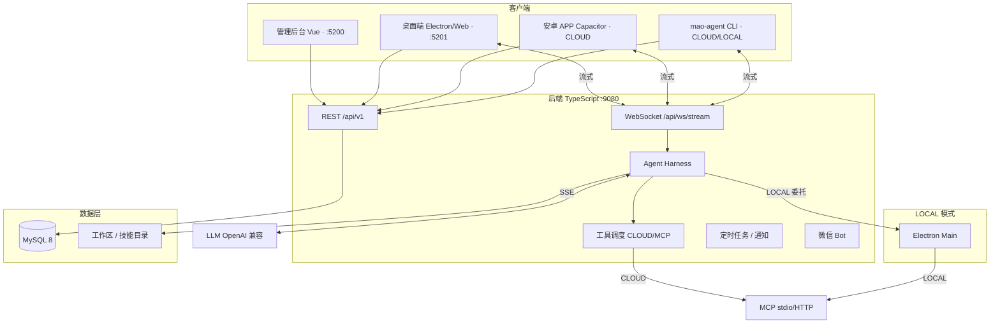

# 项目说明

## 定位

Mao 是面向个人与团队的**自托管 AI Agent 平台**。一次部署，全员共用：在服务端集中管理模型、权限与按岗位构建的智能体，成员无需安装运行环境，即可通过 Web、移动端、CLI、飞书、钉钉、微信或内部业务系统直接调用。内置 Think-Act-Observe 运行引擎、Docker 容器级隔离、团队经验库自动沉淀，以及全量会话、调用与成本审计。

- **开源**：MIT，仅提供源码与自部署文档，无官方 SaaS
- **Git**：https://github.com/DC-ET/mao
- **界面语言**：中文
- **风险提示**：尚未经企业级生产充分验证，部署前请自行评估

Logo、工作台预览和技术架构图见 GitHub 仓库 `docs/assets/logo.png`、`docs/assets/client.png`、`docs/assets/mao-architecture-tech.jpeg`。

## 为什么选择 Mao

| 维度 | Mao |
|------|-----|
| 部署与共享 | 一次私有化部署，全员共用；API Key、会话与工作区数据留在内网 |
| 多端零配置 | Web、Android、CLI、飞书、钉钉、微信、网页嵌入（Embed SDK），用户侧免安装 |
| 岗位智能体 | 按岗位配置 Agent，独立绑定提示词（带版本回滚）、Skill、MCP 与 HTTP 工具 |
| 容器级隔离 | 可选 Docker 运行时：每用户独立容器执行环境，经验库按 Agent 隔离 |
| 团队经验沉淀 | 云端会话自动归档排障与业务经验至 Agent 经验库，跨成员复用 |
| 审计与成本治理 | 全量会话留痕、LLM 调用流水、操作审计、多维成本核算与月度预算拦截 |
| 双执行边界 | **CLOUD**（服务端/容器执行）与 **LOCAL**（Electron / CLI 本机执行 + 工具审批）随时切换 |
| 认证接入 | 本地账号 / LDAP / 飞书 SSO（可选） |

若需要低代码画布编排或开箱 SaaS，可考虑 Dify、n8n；若需要团队级自托管、多端接入、岗位经验沉淀与完整的权限成本治理，选 Mao。

## 与 OpenAI Codex 对比

| 维度 | OpenAI Codex | Mao |
|------|--------------|-----|
| 形态 | 商业 SaaS | 开源 MIT，自托管 |
| 数据与密钥 | OpenAI 云端 | 留在本地/内网 |
| 入口 | App/CLI/IDE/Web | 管理后台、Web、安卓、终端、微信、飞书、钉钉、网页嵌入 |
| 模型 | OpenAI 体系 | 任意 OpenAI 兼容 API |
| 权限 | 个人/小团队 | RBAC、审计、LDAP/飞书 |
| 工具执行 | 云端 Sandbox | CLOUD + LOCAL 可切换 |
| Agent | 单一助手为主 | 按岗位多个智能体；云端经验库跨成员复用；用量统计 |
| 上手 | 注册即用 | 需自行部署 |

## 架构

## 核心特性

- **统一管理** — Agent、模型、用户、技能等
- **权限与治理** — RBAC；管理 REST 操作审计；用量分析与调用流水（含成本口径）
- **用量成本与预算** — 模型按每百万 token 配价格，调用落成本快照；按全局 / 用户 / Agent 设月度预算，超额提醒（站内信）或拦截（拒绝新任务），开放 API / 入站 Webhook 一并生效；上下文压缩可配独立便宜模型
- **双执行模式** — CLOUD / LOCAL；LOCAL 支持权限档位与工具审批
- **MCP** — 管理后台全局 MCP；桌面端用户级私有 MCP；按 Agent 注入 `mcp__{server}__{tool}`
- **多模态** — 模型类型分类；文生图/改图（generate_image / edit_image）；微信语音/图片/文件
- **协作** — Side Task、后台子代理；内置 `default` / `explorer` / `worker` / `reviewer`（对齐 Codex：通用 / 调研 / 写码 / 审查），旧名 `researcher`→`explorer`、`coder`→`worker` 自动归一。子代理不能调用 `ask_user_questions`，向用户提问只发生在主会话
- **任务自动化** — 定时任务；钉钉/飞书 Webhook 或微信通知
- **工作区** — 云端新建/复用/Git HTTPS 初始化；Git 只读诊断
- **WebSocket** — 流式对话、Token 追踪、上下文压缩提示
- **回复引用溯源** — 联网搜索 / 打开网页作答时，正文说法旁带可点击引用上标、回复末尾列「来源」；来源由服务端从真实工具结果构建白名单，模型编造或编号越界的标记自动失效（见 [desktop.md](desktop.md#回复引用溯源)）
- **云端终端** — CLOUD 任务可直接打开跑在服务端的交互式 bash（需 `terminal:use` 权限，默认只授管理员）
- **微信通道**（可选）— 扫码绑定后在微信中与 Agent 对话
- **mao-cli** — 本 Skill：产品文档 + REST CLI
- **mao-agent** — 终端对话客户端（见 [mao-agent.md](mao-agent.md)）

## 技术栈摘要

| 层 | 技术 |
|----|------|
| 后端 | TypeScript Node 22+、NestJS 11 + Fastify、MySQL 8 + Flyway、JWT |
| 前端 | Vue 3 + Vite + Element Plus + Pinia |
| 桌面 | Electron 28 |
| 安卓 | Capacitor 7，远程加载生产 Web |
| API | `/api/v1/`，Swagger `/api/swagger-ui.html` |
| 流式 | WebSocket `/api/ws/stream`；云端终端 `/api/ws/terminal` |

## 五端分工

| 端 | 目录/产物 | 用途 |
|----|-----------|------|
| 后端 | 编译产物 `dist/` | API、Harness、调度、微信 |
| 管理后台 | `admin/dist` | 平台治理与配置 |
| 桌面 Web | `desktop/dist` | 用户任务与对话（CLOUD） |
| Electron | 自行 `npm run dist` | LOCAL 工具执行 |
| 安卓 | `build-apk.sh` | Capacitor 壳 + OTA |
| mao-agent | 安装脚本 / npm | 终端对话 |
| mao-cli | 本目录 | 文档 + REST CLI |
